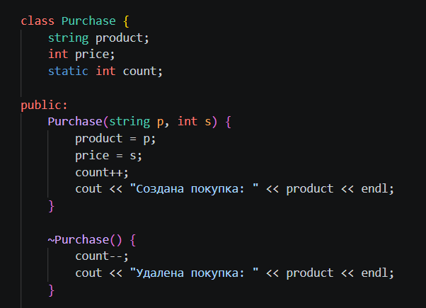
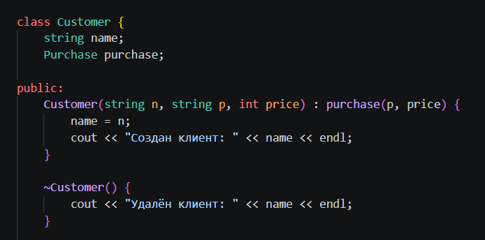
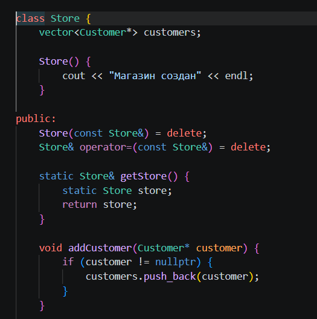
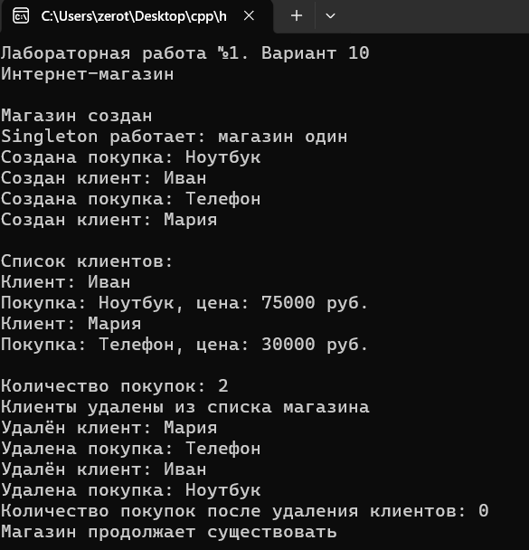

# Лабораторная работа №1

**Дисциплина:** Алгоритмы и структуры данных  
**Институт:** Институт информационных технологий и кибербезопасности  
**Кафедра:** Программная инженерия  
**Тема:** Композиция и агрегация классов. Статические члены  
**Уровень:** Продвинутый  
**Вариант:** №10  
**Выполнил:** Саакян Аргишти Самвелович  
**Группа:** ПИЖ-б-о-25-2 (2)

## 1. Цель работы

Изучить композицию и агрегацию классов в C++, научиться работать со статическими полями и методами, разобраться с паттерном Singleton и продемонстрировать создание и уничтожение объектов.

## 2. Задание

**Продвинутый уровень, вариант №10:** «Система интернет-магазина: Store (одиночка) + Customer (агрегация) + Purchase (композиция)».

Нужно реализовать классы `Store`, `Customer` и `Purchase`, показать композицию и агрегацию, добавить статический счётчик объектов и создать единственный экземпляр магазина с помощью Singleton.

## 3. Краткая теория

**Композиция** - связь между классами, при которой один объект содержит другой и управляет временем его жизни. В этой программе клиент `Customer` содержит покупку `Purchase`. Когда удаляется клиент, удаляется и его покупка.

**Агрегация** - связь, при которой объекты могут существовать независимо друг от друга. Магазин `Store` хранит указатели на клиентов `Customer*`, но не создаёт и не удаляет самих клиентов.

**Статическое поле** - переменная, общая для всех объектов класса. В классе `Purchase` поле `count` показывает количество существующих покупок. **Статический метод** `getCount()` возвращает это значение.

**Singleton** - способ создания только одного объекта класса. У магазина закрытый конструктор, а метод `getStore()` всегда возвращает один и тот же объект.

## 4. Ход выполнения работы

### 4.1. Создание проекта

В Visual Studio Code создан файл `main.cpp`. В нём написана программа интернет-магазина с тремя классами: `Purchase`, `Customer` и `Store`. Код программы находится в файле [main.cpp](main.cpp).

Класс `Purchase` хранит название и цену товара, класс `Customer` хранит имя и покупку, а класс `Store` хранит список указателей на клиентов.

**Рисунок 1 - Файл main.cpp и структура проекта в Visual Studio Code.**



### 4.2. Создание магазина и проверка Singleton

В классе `Store` конструктор закрыт, поэтому нельзя создать магазин обычной командой `Store shop;`. Получить магазин можно через метод `Store::getStore()`.

В функции `main()` метод вызывается два раза. Затем сравниваются адреса `shop` и `shop2`. Если адреса совпадают, на экран выводится сообщение `Singleton работает: магазин один`.

Для компиляции и запуска в терминале VS Code используются команды:

```powershell
g++ -std=c++17 main.cpp -o lab1.exe
.\lab1.exe
```

**Рисунок 2 - Компиляция программы и проверка Singleton.**



### 4.3. Создание клиентов и покупок

В программе созданы два клиента: Иван и Мария. У Ивана покупка «Ноутбук» за 75000 рублей, у Марии покупка «Телефон» за 30000 рублей.

Клиенты добавляются в магазин методом `addCustomer()`. Магазин хранит только адреса клиентов, поэтому это **агрегация**.

Внутри класса `Customer` есть поле `Purchase purchase`. Покупка является частью клиента, поэтому это **композиция**. Метод `show()` выводит клиентов и их покупки.

**Рисунок 3 - Вывод списка клиентов и покупок в консоль.**



### 4.4. Проверка статического счётчика и уничтожения объектов

В классе `Purchase` есть статическая переменная `count`. В конструкторе значение увеличивается на 1, а в деструкторе уменьшается на 1.

После создания Ивана и Марии программа показывает `Количество покупок: 2`.

Далее метод `shop.clear()` очищает список адресов клиентов в магазине. **Самих клиентов этот метод не удаляет.** Когда выполнение выходит из блока `{ ... }`, уничтожаются объекты клиентов, а вместе с ними и содержащиеся в них покупки. Счётчик после блока показывает `0`. Магазин при этом продолжает существовать.

**Рисунок 4 - Работа статического счётчика и уничтожение объектов.**



## 5. Результат работы

Программа создаёт единственный магазин, двух клиентов и две покупки. В консоль выводятся данные клиентов и товаров. Статический счётчик показывает количество существующих покупок: сначала 2, после уничтожения клиентов - 0.

Реализованы композиция (`Customer` и `Purchase`), агрегация (`Store` и `Customer`), статическое поле и метод (`Purchase::count`, `Purchase::getCount()`) и паттерн Singleton (`Store::getStore()`).

## 6. Ответы на контрольные вопросы

1. **Что такое композиция?** Это связь, при которой часть принадлежит целому и уничтожается вместе с ним. Пример: покупка внутри клиента.
2. **Что такое агрегация?** Это связь, при которой объекты могут существовать отдельно. Пример: магазин хранит указатели на клиентов.
3. **Как реализовать композицию в C++?** Можно объявить объект одного класса полем другого: `Purchase purchase;` внутри `Customer`.
4. **Как реализовать агрегацию в C++?** Можно использовать указатели на отдельные объекты, например `vector<Customer*> customers;`.
5. **Чем различается время жизни объектов?** При композиции часть уничтожается вместе с целым, при агрегации может существовать независимо.
6. **Что такое статическое поле?** Это одно общее поле для всех объектов класса.
7. **Как объявить статическое поле?** В классе пишется `static int count;`, а вне класса - `int Purchase::count = 0;`. У него статическое время хранения.
8. **Что такое статический метод?** Метод, который вызывается через имя класса. Он не может напрямую обращаться к обычным полям без конкретного объекта.
9. **Для чего нужен статический счётчик?** Для подсчёта количества существующих объектов.
10. **Что такое Singleton?** Способ создать единственный экземпляр класса и получать к нему общий доступ.
11. **Как запретить копирование объекта?** Использовать `Store(const Store&) = delete;` и `Store& operator=(const Store&) = delete;`.
12. **В каком порядке работают конструкторы и деструкторы при композиции?** Сначала создаётся поле-объект, потом выполняется тело конструктора внешнего класса. При уничтожении сначала выполняется тело деструктора внешнего класса, затем уничтожается его поле.
13. **Можно ли менять статическое поле из обычного метода?** Да, обычный метод может обращаться к статическому полю класса.
14. **Почему статические поля определяют вне класса?** Для обычного статического поля это создаёт его единственное определение и выделяет память.
15. **Когда использовать композицию, а когда агрегацию?** Композицию - когда один объект владеет другим; агрегацию - когда объекты независимы и один только ссылается на другой.

## 7. Вывод

В ходе лабораторной работы я научился создавать связи между классами C++, использовать статические поля и методы, работать с указателями и создавать единственный экземпляр класса с помощью Singleton. Я проверил, что покупка уничтожается вместе с клиентом, а магазин хранит только ссылки на клиентов и продолжает существовать после их уничтожения.
