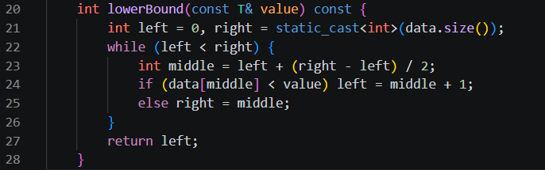
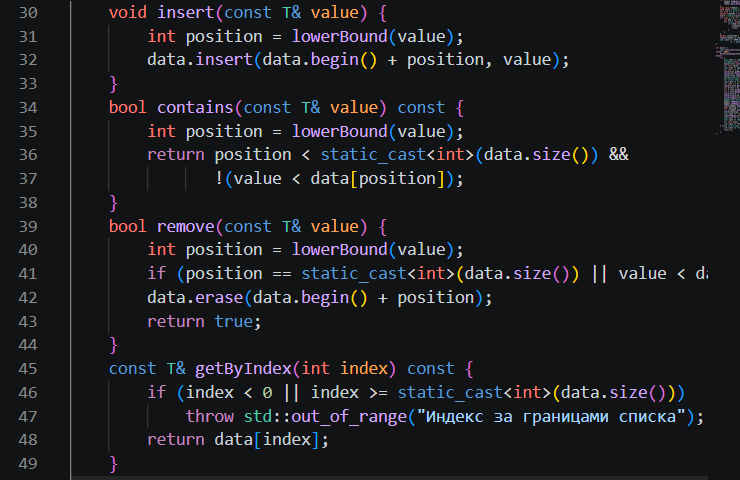
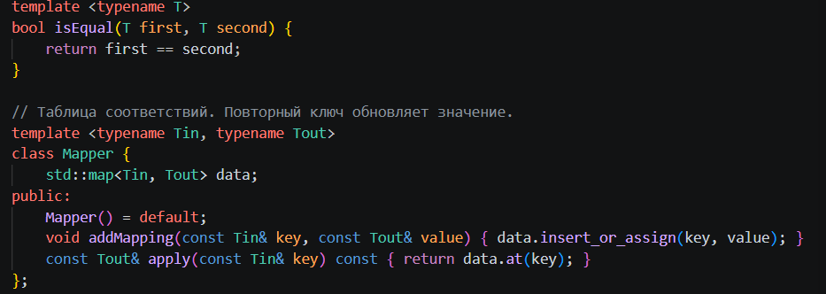
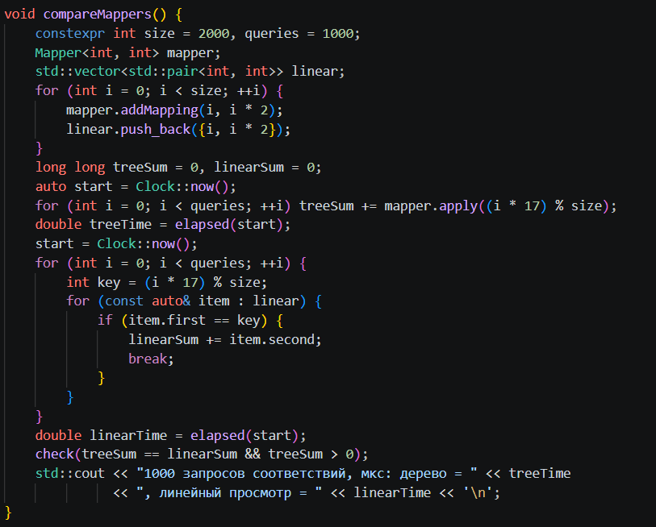
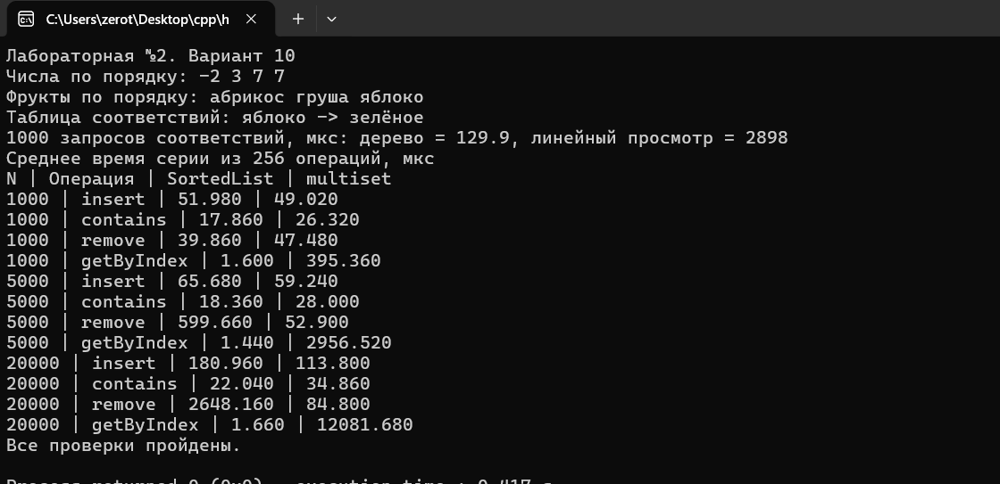

# Лабораторная работа №2

**Дисциплина** — Алгоритмы и структуры данных  
**Тема** — Анализ сложности алгоритмов. Шаблоны классов  
**Уровень** — Продвинутый  
**Вариант** — №10  
**Выполнил** — Саакян Аргишти Самвелович  
**Группа** — ПИЖ-б-о-25-2 (2)

## 1. Цель работы

Реализовать отсортированный шаблонный контейнер и сопоставить сложность операций с измерениями.

## 2. Задание

Вариант №10 — SortedList<T> с insert, contains, remove, getByIndex и сохранением порядка. Сравнить со std::multiset. Дополнительно реализованы isEqual, Mapper и два способа поиска соответствий.

## 3. Краткая теория

Бинарный поиск сужает диапазон вдвое и требует O(log n) сравнений. Вставка в середину вектора требует сдвига элементов. Шаблон T позволяет использовать один класс для разных типов.

## 4. Ход выполнения работы

Исходный файл — [main.cpp](main.cpp).

### 4.1. Бинарный поиск позиции

Поиск работает в полуоткрытом диапазоне [left, right). Возвращается индекс первого значения, которое не меньше ключа.



**Рисунок 1 - Бинарный поиск позиции.**

### 4.2. Операции отсортированного списка

Вставка использует найденную позицию. remove удаляет одно вхождение. Индексы с нуля, неверный индекс вызывает исключение.



**Рисунок 2 - Операции отсортированного списка.**

### 4.3. Сравнение и таблица соответствий

isEqual применяет оператор равенства. Mapper хранит пары в std::map, обновляет повторный ключ и сообщает об отсутствии ключа.



**Рисунок 3 - Сравнение и таблица соответствий.**

### 4.4. Сравнение поиска соответствий

Одни и те же 1000 запросов выполняются по дереву и линейным просмотром 2000 пар. Суммы сверяются вне замера.



**Рисунок 4 - Сравнение поиска соответствий.**

## 5. Анализ сложности

| Операция | Время / память | Обоснование |
|---|---|---|
| lowerBound, contains | O(log n) | Бинарное сужение диапазона. |
| insert, remove | O(n) | Поиск позиции и возможный сдвиг хвоста. |
| getByIndex, size | O(1) | Доступ по индексу или к полю. |
| isEqual | O(1) для чисел, O(L) для строк | Учитываются сравнение и копирование аргументов. |
| Mapper: конструктор; addMapping, apply | O(1); O(log m) | m — число ключей, при постоянной стоимости сравнения. |
| std::multiset: вставка, поиск, удаление по ключу | O(log n) | Сбалансированное дерево. |
| std::multiset: доступ по индексу | O(n) | Продвижение итератора от начала. |

## 6. Сборка и результаты

Команды PowerShell из папки работы. Используется C++17, как в предыдущих лабораторных.

```powershell
g++ -std=c++17 -O2 -Wall -Wextra -Wpedantic -finput-charset=UTF-8 -fexec-charset=UTF-8 -static main.cpp -o lab2.exe
if ($LASTEXITCODE -eq 0) { .\lab2.exe }
```

Контрольная сборка выполнена GCC 14.2.0 под Windows с перечисленными предупреждениями и дополнительным флагом -Werror. Все программы завершились успешно.

| Вход / действие | Ожидаемый результат | Проверено |
|---|---|---|
| 7, -2, 7, 3 | -2 3 7 7 | Совпало |
| Два удаления 7 | После первого 7 остаётся, после второго отсутствует | Совпало |
| яблоко, абрикос, груша | абрикос груша яблоко | Совпало |
| Индекс -1 и индекс size() | Два исключения | Перехвачены |
| 5000 случайных операций | Совпадение со std::multiset | Совпало |

### 6.1. Результаты и методика

На каждом N выполняются пять повторов по 256 операций. В таблице среднее время целой серии, мкс. Генерация ключей и сверка результатов исключены из замера. Половина запросов поиска успешна. Первым всегда измеряется SortedList, что может влиять на абсолютные числа.

Контрольные измерения при подготовке работы.

| N | Операция | SortedList, мкс / серия | multiset, мкс / серия |
|---|---|---|---|
| 1000 | insert | 22.660 | 13.980 |
| 1000 | contains | 6.840 | 6.300 |
| 1000 | remove | 16.800 | 15.160 |
| 1000 | getByIndex | 0.100 | 326.220 |
| 5000 | insert | 38.060 | 16.200 |
| 5000 | contains | 8.120 | 8.800 |
| 5000 | remove | 534.880 | 20.660 |
| 5000 | getByIndex | 0.120 | 2588.360 |
| 20000 | insert | 141.480 | 37.500 |
| 20000 | contains | 9.720 | 14.120 |
| 20000 | remove | 2449.300 | 28.140 |
| 20000 | getByIndex | 0.200 | 10750.180 |

Время повторного запуска может отличаться. Для согласованной сдачи перенеси в таблицу числа своего запуска, показанные на снимке консоли.



**Рисунок 5 - Результаты запуска программы.**

### 6.3. Особенности реализации

Для учебных примеров A–E методички оценки равны O(n), O(n²), O(log n), O(n log n), O(√n) при постоянной стоимости тела и без переполнения. Индивидуальные фрагменты преподавателя в PDF отсутствуют, их анализ нужно добавить после получения. График исключён по выбранному формату, хотя в критериях он указан вместе с таблицей.

## 7. Ответы на контрольные вопросы

1. **Что такое О-нотация (Big O) и зачем она нужна?** О-нотация задаёт верхнюю асимптотическую границу затрат. Например, 3n + 7 относится к O(n).

2. **Какая сложность у доступа к элементу массива по индексу? Почему?** O(1), поскольку адрес ячейки вычисляется по индексу и размеру элемента.

3. **Какая сложность у бинарного поиска? Почему?** O(log n), поскольку диапазон после сравнения со средним элементом уменьшается примерно вдвое.

4. **Что означает сложность O(n log n)? Приведите пример алгоритма.** Число операций растёт пропорционально n log n. Пример — сортировка слиянием.

5. **Что такое амортизированный анализ? Приведите пример.** Амортизированный анализ оценивает последовательность операций целиком. При удвоении буфера вставка в конец массива стоит O(1) амортизированно, отдельное расширение — O(n).

6. **Какая сложность у двух вложенных циклов по n итераций каждый?** При постоянной стоимости тела получаем n² выполнений и O(n²).

7. **Какая сложность у рекурсивного вычисления чисел Фибоначчи?** Прямая рекурсия повторно считает одни и те же подзадачи. Верхняя оценка времени O(2ⁿ), глубина стека O(n).

8. **Что такое шаблоны функций? Как их объявить и использовать?** Перед определением пишут template <typename T>. При вызове тип выводится из аргументов или указывается явно.

9. **Что такое шаблоны классов? Как их объявить и использовать?** Объявление класса начинается с template <typename T>. Например, SortedList<int> хранит числа, а SortedList<std::string> — строки.

10. **В чём преимущество шаблонов перед перегрузкой функций?** Один шаблон описывает общий алгоритм для нескольких типов. Перегрузки подходят, когда типы требуют разного поведения.

11. **Как указать, что шаблонный параметр - тип?** В списке параметров пишут typename T или class T. Обе формы задают параметр типа.

12. **Можно ли создать шаблон с несколькими параметрами типов?** Да, например Mapper<Tin, Tout> задаёт два независимых типа для ключа и результата.

13. **Как провести экспериментальное измерение времени выполнения?** Показания монотонных часов считывают до и после серии операций. Подготовка данных и вывод выполняются отдельно.

14. **Почему при измерении времени нужно выполнять операцию многократно?** Серия увеличивает интервал измерения и уменьшает относительное влияние таймера. Повторы помогают оценить случайные задержки.

15. **Что важнее: сложность алгоритма или константа?** На маленьких входах существенны константы и размещение данных. При увеличении входа сильнее проявляется асимптотический порядок.

## 8. Вывод

В ходе работы я реализовал требуемые операции и проверил их на обычных и граничных примерах. Дерево быстрее вставляло и удаляло элементы на больших входах, а вектор давал быстрый доступ по индексу.

[Git-репозиторий с лабораторными](https://github.com/sakiriyan/saakian-cpp-lab)
