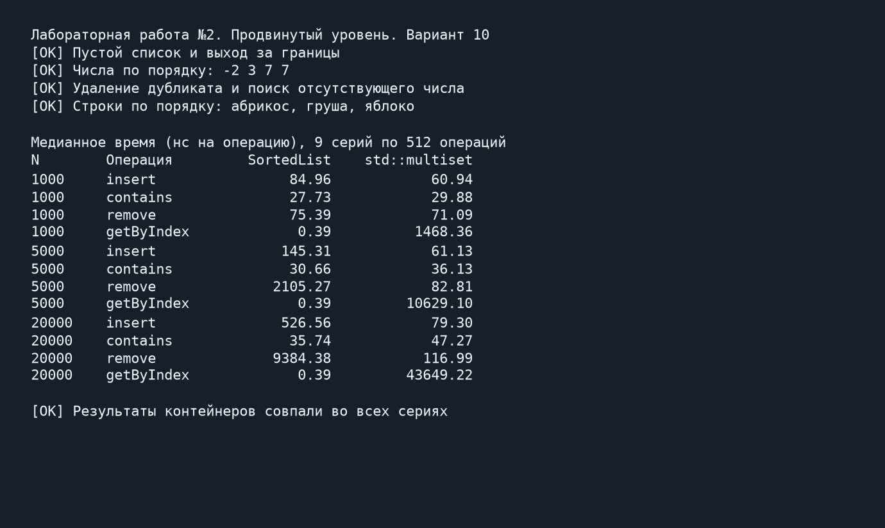
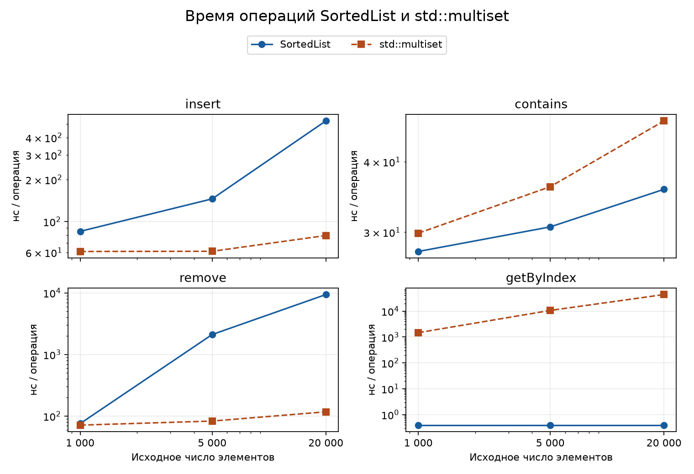

# Лабораторная работа №2

**Дисциплина** — Алгоритмы и структуры данных  
**Институт** — Институт информационных технологий и кибербезопасности  
**Кафедра** — Программная инженерия  
**Тема** — Анализ сложности алгоритмов. Шаблоны классов  
**Уровень** — Продвинутый  
**Вариант** — №10  
**Выполнил** — Саакян Аргишти Самвелович  
**Группа** — ПИЖ-б-о-25-2 (2)

## 1. Цель работы

Научиться реализовывать шаблонные контейнеры на C++, оценивать сложность их операций и сопоставлять теоретическую оценку с результатами измерений.

## 2. Задание

Реализовать шаблонный контейнер `SortedList<T>`, который хранит элементы в отсортированном порядке и поддерживает операции `insert`, `contains`, `remove` и `getByIndex`. Оценить сложность каждой операции. Сравнить производительность со стандартным контейнером STL и представить измерения в таблице и на графике.

## 3. Краткая теория

**О-нотация** задаёт верхнюю границу роста затрат алгоритма с увеличением размера входа. Основные классы сложности в этой работе — `O(1)` для доступа по индексу в массиве, `O(log n)` для бинарного поиска и `O(n)` для сдвига элементов.

**Шаблон класса** позволяет описать одну структуру данных для разных типов. В `SortedList<T>` тип `T` должен поддерживать сравнение через `<` и операции копирования и перемещения, необходимые вектору. Для строк порядок определяется стандартным сравнением `std::string`.

## 4. Ход выполнения работы

### 4.1. Как устроен `SortedList<T>`

Тип `T` задаётся при создании списка. Например, `SortedList<int>` хранит числа, а `SortedList<std::string>` — строки. Вектор `values` закрыт внутри класса. Элементы добавляются через `insert`, поэтому класс может поддерживать порядок.

```cpp
template <typename T>
class SortedList {
    std::vector<T> values;
```

**Рисунок 1 - Объявление шаблона класса SortedList и поле для хранения элементов.**

### 4.2. Вставка элемента

Функция `std::lower_bound` находит первый элемент, который больше добавляемого значения или равен ему. `insert` вставляет новое значение перед найденной позицией. Если все элементы меньше, позиция указывает на конец. Например, вставка числа 3 в `[-2, 7, 7]` даёт `[-2, 3, 7, 7]`.

```cpp
void insert(const T& value) {
    // lower_bound указывает на первый элемент, который не меньше value.
    const auto position = std::lower_bound(values.begin(), values.end(), value);
    values.insert(position, value);
}
```

**Рисунок 2 - Вставка элемента с сохранением порядка.**

### 4.3. Поиск элемента

Метод возвращает `true`, если значение есть. Бинарный поиск сравнивает ключ со средним элементом и после каждого сравнения отбрасывает половину оставшегося диапазона. Для списка `[-2, 3, 7, 7]` поиск 7 вернёт `true`, а поиск 4 — `false`.

```cpp
bool contains(const T& value) const {
    return std::binary_search(values.begin(), values.end(), value);
}
```

**Рисунок 3 - Поиск элемента в отсортированном списке.**

### 4.4. Удаление одного вхождения

Для пустого списка метод сразу возвращает `false`. В остальных случаях `lower_bound` находит первое подходящее место. Если поиск дошёл до конца или нашёл значение строго больше искомого, удалять нечего. Иначе `erase` удаляет один элемент. После удаления 7 из `[-2, 3, 7, 7]` остаётся `[-2, 3, 7]`.

```cpp
bool remove(const T& value) {
    if (values.empty()) {
        return false;
    }
    const auto position = std::lower_bound(values.begin(), values.end(), value);
    if (position == values.end() || value < *position) {
        return false;
    }
    values.erase(position);
    return true;
}
```

**Рисунок 4 - Удаление одного вхождения элемента.**

### 4.5. Получение значения по индексу

Индексы начинаются с нуля. Для списка `[-2, 3, 7]` вызов `getByIndex(1)` вернёт копию числа 3. Вызов с индексом 3 приведёт к исключению `std::out_of_range`, потому что `at` проверяет границы.

```cpp
T getByIndex(std::size_t index) const {
    return values.at(index);
}
```

**Рисунок 5 - Получение элемента по индексу.**

### 4.6. Проверка на русских строках

Слова добавляются в порядке «яблоко, абрикос, груша». Функция `checkOrder` сверяет элементы по индексам с ожидаемым порядком, а затем проверяет, что обращение за последним элементом вызывает исключение.

```cpp
SortedList<std::string> words;
const std::string fruits[] = {"яблоко", "абрикос", "груша"};
for (const std::string& word : fruits) {
    words.insert(word);
}
checkOrder(words, {"абрикос", "груша", "яблоко"});
```

**Рисунок 6 - Проверка порядка русских строк.**

### 4.7. Измерение времени

Функция `measure` принимает операцию и выполняет её серией. Результаты записываются в подготовленный массив для последующей сверки. Разность показаний часов делится на количество операций, поэтому функция возвращает среднее время одной операции в наносекундах.

```cpp
template <typename Operation>
double measure(Operation operation, std::vector<int>& results) {
    const auto start = std::chrono::steady_clock::now();
    for (std::size_t i = 0; i < results.size(); ++i) {
        results[i] = operation(i);
    }
    const auto finish = std::chrono::steady_clock::now();
    return std::chrono::duration<double, std::nano>(finish - start).count()
           / results.size();
}
```

**Рисунок 7 - Измерение среднего времени операции.**

### 4.8. Сборка и запуск

Исходный файл — [main.cpp](main.cpp). Сборка и запуск из папки лабораторной в PowerShell с MinGW.

```powershell
g++ -std=c++17 -O2 -Wall -Wextra -Wpedantic -static main.cpp -o lab2.exe
.\lab2.exe
```

### 4.9. Анализ сложности

Пусть `n` — число элементов, а сравнение, копирование и перемещение одного элемента занимают постоянное время, как для `int`.

| Операция | SortedList | std::multiset | Обоснование |
|---|---|---|---|
| `insert` | `O(n)` в худшем случае | `O(log n)` | Бинарный поиск позиции занимает `O(log n)`. Вектор сдвигает хвост и при расширении перемещает элементы в новый буфер. |
| `contains` | `O(log n)` | `O(log n)` | Вектор использует бинарный поиск, дерево — поиск по ключу. |
| `remove` | `O(n)` в худшем случае | `O(log n)` амортизированно | Вектор ищет позицию и сдвигает хвост. У дерева поиск занимает `O(log n)`, удаление по найденному итератору — амортизированно `O(1)`. |
| `getByIndex` | `O(1)` | `O(n)` в худшем случае | Вектор обращается к ячейке по индексу. Итератор дерева проходит от начала до нужной позиции. |

Оба контейнера используют `O(n)` памяти. При расширении вектора старый и новый буферы временно существуют одновременно. Для `std::string` стоимость сравнения зависит от числа сравниваемых байтов, а получение копии строки зависит от её длины.

### 4.10. Методика измерений

Оба контейнера заполнялись одинаковыми чётными числами. Для исходных размеров 1 000, 5 000 и 20 000 элементов выполнялось по девять серий из 512 операций каждого вида. В каждой серии в обе структуры добавлялись одни и те же нечётные ключи, затем выполнялись поиск и доступ по индексу, после чего добавленные ключи удалялись. Половина запросов поиска обращалась к существующим ключам, половина — к отсутствующему. Ёмкость вектора между сериями сохранялась.

Ключи вставки и индексы генерировались с фиксированным начальным значением 42. Очередность контейнеров чередовалась. По часам `std::chrono::steady_clock` измерялось время серии с записью результатов в заранее выделенный буфер. Подготовка данных, сверка результатов и вывод выполнялись за пределами замера. В таблицу внесена медиана среднего времени операции по девяти сериям. Среда измерений — Windows, GCC 14.2.0, оптимизация `-O2`.

## 5. Результаты работы

Сборка и запуск прошли успешно. Программа проверила порядок целых чисел и русских строк, поиск существующих и отсутствующих значений, удаление одного дубликата, поведение на пустом списке и выход за границы. Порядок элементов и результаты операций сверены с `std::multiset`.

**Вывод программы при контрольном запуске**



**Рисунок 8 - Фактический вывод программы из журнала запуска.**

Текстовая копия вывода приведена ниже.

```text
Лабораторная работа №2. Продвинутый уровень. Вариант 10
[ОК] Пустой список и выход за границы
[ОК] Числа по порядку: -2 3 7 7
[ОК] Удаление дубликата и поиск отсутствующего числа
[ОК] Строки по порядку: абрикос, груша, яблоко

Медианное время (нс на операцию), 9 серий по 512 операций
N        Операция         SortedList    std::multiset
1000     insert                84.96            60.94
1000     contains              27.73            29.88
1000     remove                75.39            71.09
1000     getByIndex             0.39          1468.36
5000     insert               145.31            61.13
5000     contains              30.66            36.13
5000     remove              2105.27            82.81
5000     getByIndex             0.39         10629.10
20000    insert               526.56            79.30
20000    contains              35.74            47.27
20000    remove              9384.38           116.99
20000    getByIndex             0.39         43649.22

[ОК] Результаты контейнеров совпали во всех сериях
```

**Таблица 1 — Медианное время в наносекундах на операцию**

| Исходный размер | Операция | SortedList | std::multiset |
|---:|---|---:|---:|
| 1000 | `insert` | 84.96 | 60.94 |
| 1000 | `contains` | 27.73 | 29.88 |
| 1000 | `remove` | 75.39 | 71.09 |
| 1000 | `getByIndex` | 0.39 | 1468.36 |
| 5000 | `insert` | 145.31 | 61.13 |
| 5000 | `contains` | 30.66 | 36.13 |
| 5000 | `remove` | 2105.27 | 82.81 |
| 5000 | `getByIndex` | 0.39 | 10629.10 |
| 20000 | `insert` | 526.56 | 79.30 |
| 20000 | `contains` | 35.74 | 47.27 |
| 20000 | `remove` | 9384.38 | 116.99 |
| 20000 | `getByIndex` | 0.39 | 43649.22 |



**Рисунок 9 - Сравнение времени операций SortedList и std::multiset.**

Обе оси графика логарифмические.

В этом запуске `std::multiset` быстрее вставлял и удалял элементы на всех трёх размерах. Поиск в векторе был немного быстрее. Получение элемента по индексу заняло меньше всего времени в векторе, а время прохода по дереву росло с размером списка. Значение меньше одной наносекунды для вектора получено делением времени всей серии на 512. Оно отражает среднее время операции в оптимизированном цикле. Числа зависят от компьютера, компилятора и порядка данных.

## 6. Ответы на контрольные вопросы

1. **Что такое О-нотация и зачем она нужна?** Она ограничивает сверху темп роста затрат при больших входах. Например, время `3n + 10` относится к `O(n)`. Это позволяет сравнивать масштабируемость алгоритмов.
2. **Какая сложность у доступа к элементу массива по индексу?** `O(1)`. Адрес ячейки вычисляется из начального адреса и смещения, равного индексу, умноженному на размер элемента.
3. **Какая сложность у бинарного поиска?** `O(log n)`. После сравнения со средним элементом оставшийся диапазон примерно вдвое сокращается. Данные должны быть отсортированы.
4. **Что означает `O(n log n)`?** Рост затрат ограничен величиной, пропорциональной `n log n`. Например, сортировка слиянием проходит `log₂ n` уровней деления с суммарной работой `O(n)` на каждом.
5. **Что такое амортизированный анализ?** Это оценка стоимости одной операции по суммарной стоимости последовательности. При добавлении в конец вектора отдельное расширение стоит `O(n)`, но при геометрическом росте буфера суммарная стоимость `m` добавлений равна `O(m)`.
6. **Какая сложность у двух вложенных циклов по `n` итераций?** При постоянной стоимости тела получается `n × n = n²` выполнений и сложность `O(n²)`.
7. **Какая сложность у рекурсивного вычисления чисел Фибоначчи?** Прямая рекурсия без запоминания вызывает функции для `n−1` и `n−2` и многократно пересчитывает одни и те же значения. Время экспоненциальное, его можно оценить сверху как `O(2ⁿ)`. Глубина стека составляет `O(n)`.
8. **Как объявить и использовать шаблон функции?** Перед определением пишут `template <typename T>`. Например, для `template <typename T> T twice(T x) { return x + x; }` вызов `twice(3)` выводит тип `int` из аргумента.
9. **Как объявить и использовать шаблон класса?** Объявление начинается с `template <typename T> class SortedList`. При создании объекта задают тип элементов, например `SortedList<int> numbers;`.
10. **В чём преимущество шаблонов перед перегрузкой функций?** Один шаблон описывает общий алгоритм для типов с нужными операциями. Перегрузки подходят, когда реализация зависит от типа и требуется несколько разных вариантов поведения.
11. **Как указать, что шаблонный параметр — тип?** В списке параметров пишут `typename T` или `class T`. В этом месте обе записи объявляют параметр типа.
12. **Можно ли создать шаблон с несколькими параметрами типов?** Да. Например, `template <typename Key, typename Value>` задаёт два независимых типа, которые можно использовать для ключа и значения.
13. **Как измерить время выполнения?** Считать показания монотонных часов до и после серии операций, вычислить разность и поделить её на число операций. Подготовку входных данных и вывод следует выполнить отдельно.
14. **Почему операции измеряют многократно?** Быстрая операция может занимать меньше интервала, который надёжно различает таймер. Серия делает интервал длиннее, а медиана нескольких серий уменьшает влияние отдельных задержек.
15. **Что важнее, сложность или константа?** Это зависит от размера данных. На малом входе накладные расходы могут определять результат, а при росте входа заметнее становится различие в темпе роста затрат.

## 7. Вывод

Я реализовал шаблонный отсортированный список и проверил его на числах и строках. Бинарный поиск позволяет быстро найти позицию, но вставка и удаление в середине вектора требуют сдвига элементов. Замеры показали, как выбор структуры данных влияет на время разных операций.

[Git-репозиторий для кода лабораторной](https://github.com/sakiriyan/saakian-cpp-lab)
