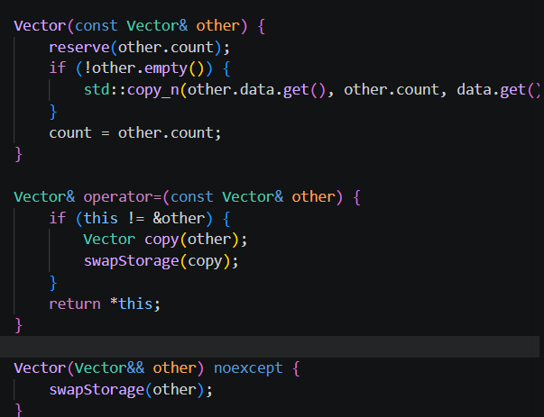
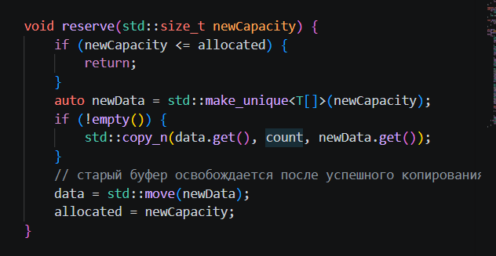
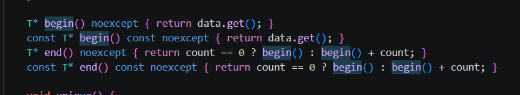
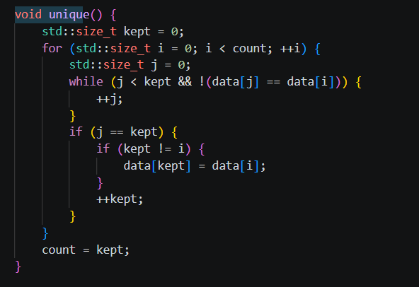
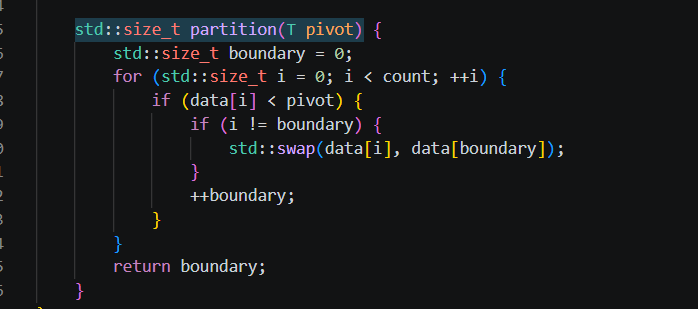
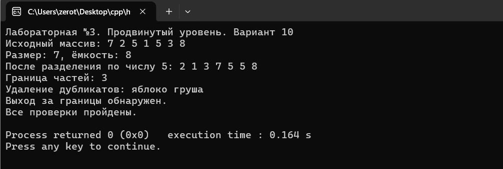

# Лабораторная работа №3

**Дисциплина** — Алгоритмы и структуры данных  
**Тема** — Реализация динамического массива (аналог vector). Итераторы  
**Уровень** — Продвинутый  
**Вариант** — №10  
**Выполнил** — Саакян Аргишти Самвелович  
**Группа** — ПИЖ-б-о-25-2 (2)

## 1. Цель работы

Реализовать шаблонный динамический массив, научиться безопасно управлять его памятью и использовать итераторы. Проверить разделение массива по опорному значению.

## 2. Задание

Создать класс `Vector<T>` с правилом пяти и итераторами `begin()`, `end()`. В варианте №10 реализовать `partition(pivot)`. Для выполнения накопительных критериев в том же классе предусмотрены конструктор с размером и значением, `push_back`, `size`, `empty`, `reserve` и `unique`.

## 3. Краткая теория

Элементы динамического массива хранятся подряд. Размер показывает число используемых ячеек, а ёмкость — число выделенных ячеек. При заполнении буфера `push_back` увеличивает ёмкость вдвое. За счёт этого дорогие копирования происходят всё реже.

Каждый объект владеет буфером через `std::unique_ptr<T[]>`. При копировании выделяется самостоятельный буфер, а при перемещении передаётся владение. Итераторы представлены указателями на элементы массива.

## 4. Ход выполнения работы

### 4.1. Копирование и перемещение

Конструктор копирования переносит значения в новый буфер. При копирующем присваивании сначала создаётся временная копия, затем она обменивается буферами с текущим объектом. При перемещении передаётся уже выделенный буфер, а источник становится пустым.



**Рисунок 1 - Копирование и перемещение динамического массива.**

### 4.2. Выделение памяти и добавление

`reserve` выделяет новый буфер и копирует в него используемые элементы. Замена старого буфера происходит после успешного копирования. `push_back` добавляет элемент в первую свободную ячейку и при необходимости увеличивает ёмкость. При расширении значение заранее сохраняется на случай, если вызов выглядит как `v.push_back(v[0])`.



**Рисунок 2 - Выделение нового буфера и добавление элемента.**

### 4.3. Итераторы

`begin()` возвращает указатель на первый элемент, а `end()` — на позицию за последним. У пустого массива обе границы равны. По этим двум методам цикл `for (const T& value : values)` понимает, откуда начать обход и где остановиться.



**Рисунок 3 - Итераторы начала и конца массива.**

### 4.4. Удаление повторяющихся значений

`unique()` просматривает массив слева направо и проверяет, есть ли текущее значение среди уже сохранённых. Если его нет, значение переносится в начало массива за последним уникальным элементом. После прохода размер уменьшается до числа оставленных значений. Первое вхождение каждого значения остаётся на своём месте относительно других уникальных значений.



**Рисунок 4 - Фильтрация повторяющихся значений.**

### 4.5. Разделение по опорному значению

Переменная `boundary` хранит длину левой части. При встрече элемента меньше `pivot` алгоритм меняет его местами с элементом на границе и сдвигает границу вправо. После прохода слева находятся значения меньше опорного, а справа — больше или равные. Метод возвращает индекс начала правой части.



**Рисунок 5 - Разделение массива на две части.**

## 5. Сложность операций

Пусть `n` — число элементов. Сравнение, присваивание и уничтожение одного элемента считаются операциями постоянной стоимости.

| Операция | Время | Обоснование |
|---|---|---|
| Пустой конструктор, `size`, `capacity`, `empty`, `operator[]`, `begin`, `end` | O(1) | Работа с полями или отдельной ячейкой. |
| Конструктор с размером и значением, конструктор копирования | O(n) | Создание и заполнение нового буфера. |
| Копирующее присваивание | O(n + c) | Копирование источника и освобождение старого буфера ёмкости `c`. |
| Конструктор перемещения | O(1) | Передача указателя, размера и ёмкости. |
| Перемещающее присваивание, деструктор | O(c) для типов с нетривиальным деструктором | Освобождение ранее выделенного массива ёмкости `c`. |
| `reserve(k)` | O(k) при росте, O(1) иначе | Создание `k` ячеек и копирование используемых значений. |
| `push_back` | O(1) амортизированно, O(n) при расширении | Большинство вставок используют свободное место. |
| `unique` | O(n²) в худшем случае | Каждый элемент может сравниваться со всеми ранее сохранёнными. |
| `partition` | O(n) | Один проход и не более одного обмена на элемент. |

Память контейнера пропорциональна ёмкости. `partition` и `unique` используют O(1) дополнительной памяти по числу элементов. Учебная реализация создаёт объекты на всю ёмкость, поэтому тип должен поддерживать создание значения по умолчанию. `unique` уменьшает логический размер с сохранением буфера.

## 6. Сборка и результаты

Исходный код находится в [main.cpp](main.cpp). Команды для PowerShell с MinGW из папки `lab3`.

```powershell
g++ -std=c++17 -O2 -Wall -Wextra -Wpedantic -static main.cpp -o lab3.exe
.\lab3.exe
```

| Проверка | Результат |
|---|---|
| Добавление семи чисел | Размер 7, ёмкость 8 |
| Разделение по числу 5 | Граница 3, слева значения 2, 1, 3 |
| Пустой массив и крайние границы разделения | Возвращаются границы 0 или размер массива |
| Удаление повторов из строк | Остались «яблоко» и «груша» |
| Копирование, самоприсваивание и перемещение | Копия независима, перемещённый объект можно использовать снова |
| Индекс за пределами массива | Перехвачено исключение `std::out_of_range` |



**Рисунок 6 - Результаты запуска и проверок динамического массива.**

## 7. Ответы на контрольные вопросы

1. **Почему массив динамический?** Память выделяется во время выполнения программы, а при нехватке места новый буфер позволяет увеличить ёмкость.
2. **Чем ёмкость отличается от размера?** Размер относится к существующим логическим элементам, ёмкость определяет, сколько элементов можно хранить до нового выделения.
3. **Зачем удваивать ёмкость?** Копирования при расширениях образуют геометрическую сумму. При росте на фиксированное число суммарная стоимость последовательных вставок может стать квадратичной.
4. **Какая амортизированная сложность `push_back`?** O(1). За `n` вставок число переносов при всех расширениях пропорционально `n`.
5. **Что такое правило трёх?** Класс, который вручную управляет ресурсом, обычно определяет деструктор, конструктор копирования и копирующее присваивание вместе.
6. **Что добавляет правило пяти?** Конструктор перемещения и перемещающее присваивание для передачи владения ресурсом.
7. **Чем копирующий конструктор отличается от присваивания?** Первый создаёт объект, второе заменяет содержимое уже существующего объекта с учётом его ресурса.
8. **Зачем проверять `this != &other`?** Чтобы при присваивании самому себе пропустить лишнюю работу и сохранить состояние объекта.
9. **Что такое итератор?** Объект для доступа к текущему элементу и перехода к следующему. В непрерывном массиве эту роль может выполнять указатель.
10. **Зачем `begin()` и `end()`?** Они задают полуоткрытый диапазон от первого элемента до позиции после последнего.
11. **Как работает range-based for?** Цикл получает границы, разыменовывает текущий итератор и увеличивает его до достижения конца.
12. **Что такое глубокое копирование?** У копии появляется собственный буфер со значениями. При поверхностном копировании указателя оба объекта ссылались бы на одну память.
13. **Зачем нужна семантика перемещения?** Она передаёт буфер без копирования каждого элемента. Источник остаётся корректным объектом.
14. **Зачем конструктору перемещения `noexcept`?** Он гарантирует отсутствие исключений при передаче владения. Стандартные контейнеры могут учитывать эту гарантию при расширении.
15. **Как освободить память в деструкторе?** Массив, выделенный через `new[]`, освобождается через `delete[]`. Здесь это автоматически делает `std::unique_ptr<T[]>`.

## 8. Вывод

Я реализовал динамический массив, проверил копирование, перемещение и обход через итераторы. Метод `partition` делит элементы на две группы за один проход.

[Репозиторий с лабораторными работами](https://github.com/sakiriyan/saakian-cpp-lab)
