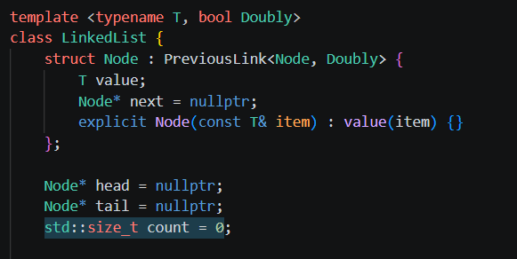
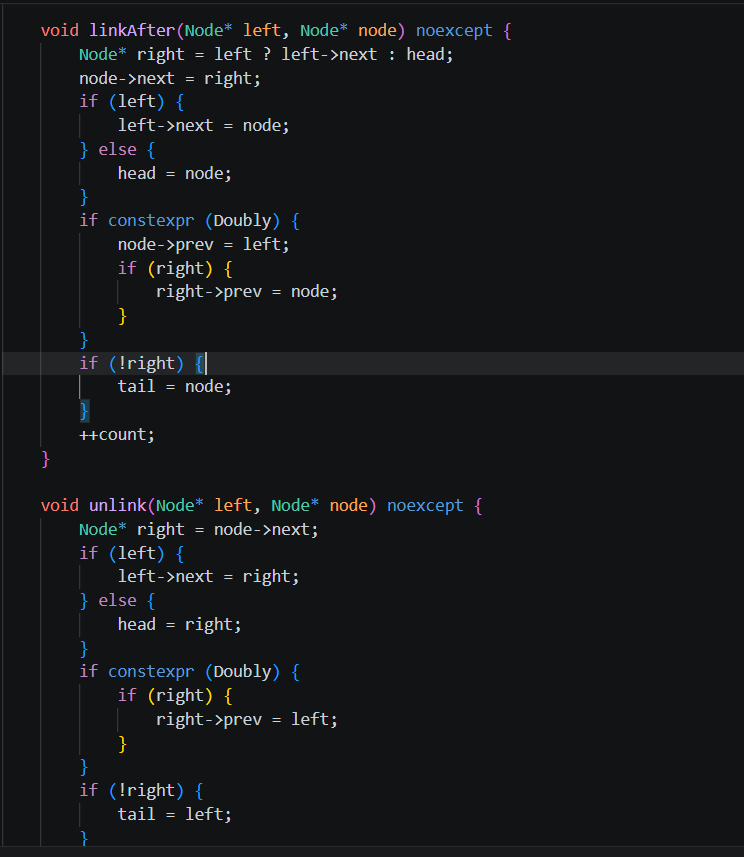
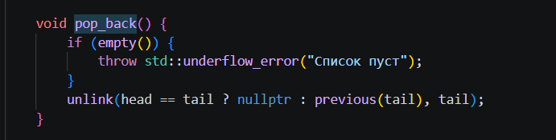
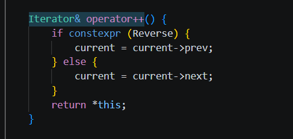
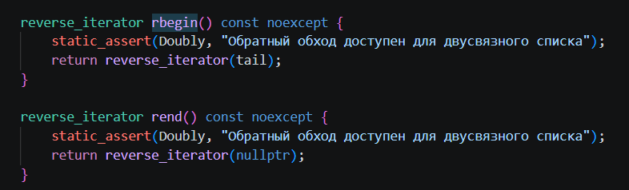
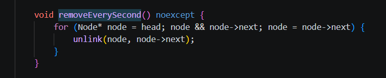
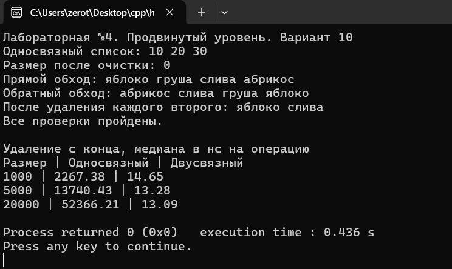

# Лабораторная работа №4

**Дисциплина** — Алгоритмы и структуры данных  
**Тема** — Односвязный и двусвязный списки  
**Уровень** — Продвинутый  
**Вариант** — №10  
**Выполнил** — Саакян Аргишти Самвелович  
**Группа** — ПИЖ-б-о-25-2 (2)

## 1. Цель работы

Реализовать односвязный и двусвязный списки, научиться менять связи между узлами и обходить двусвязный список с конца. Сравнить стоимость удаления последнего элемента.

## 2. Задание

Реализовать `SinglyLinkedList<T>` и `DoublyLinkedList<T>` с операциями вставки, удаления, поиска и очистки. Требование варианта №10 — `reverse_iterator` для двусвязного списка. Для накопительных критериев продемонстрировать размер односвязного списка после очистки и удаление каждого второго элемента двусвязного списка. Реализовать прямые итераторы и операторы сравнения, провести замеры.

## 3. Краткая теория

Узел хранит значение и указатель `next` на следующий узел. У двусвязного списка есть также `prev` для перехода назад. Указатели `head` и `tail` обозначают первый и последний узлы. У пустого списка оба равны `nullptr`.

Обе разновидности используют общий шаблон `LinkedList<T, Doubly>`. При `Doubly = false` узел хранит одну ссылку. При `Doubly = true` в узле дополнительно появляется `prev`, а при вставке и удалении обновляются обе связи.

## 4. Ход выполнения работы

### 4.1. Узлы и границы списка

В узле хранятся значение и `next`. Поле `prev` добавляется только в двусвязной версии через `PreviousLink`. В самом списке `head` и `tail` дают доступ к концам, а `count` хранит размер.



**Рисунок 1 - Узлы и поля связного списка.**

### 4.2. Вставка и удаление узлов

`linkAfter` присоединяет новый узел между его соседями. Если левого соседа нет, новый узел становится головой. Если правого нет, он становится хвостом. `unlink` соединяет соседей удаляемого узла, обновляет границы и освобождает память.



**Рисунок 2 - Обновление связей при вставке и удалении узла.**

### 4.3. Удаление последнего элемента

Для списка из одного элемента `pop_back` удаляет единственный узел. Для более длинного списка нужен предшественник хвоста. Двусвязный список получает его по `prev`, а односвязный ищет его от головы. При попытке удаления из пустого списка выбрасывается `std::underflow_error`.



**Рисунок 3 - Удаление последнего узла.**

### 4.4. Обратный итератор

Итератор хранит указатель `current` и возвращает значение узла при разыменовании. Оператор `++` у прямого итератора идёт по `next`, а у обратного — по `prev`.



**Рисунок 4 - Шаг прямого и обратного итераторов.**

`rbegin()` начинает обход с хвоста. После головы итератор указывает на `nullptr` и становится равен `rend()`. У пустого списка эти границы равны, поэтому тело цикла сразу пропускается.



**Рисунок 5 - Начало и конец обратного обхода.**

### 4.5. Удаление каждого второго элемента

Цикл оставляет текущий узел и удаляет следующий. После удаления он переходит к следующему оставшемуся узлу. Так удаляются позиции 2, 4, 6 и далее. Если удаляется последний узел, `unlink` назначает новый хвост.



**Рисунок 6 - Удаление каждого второго узла.**

## 5. Сложность операций

Пусть `n` — длина списка. Сравнение и копирование значения одного узла считаются операциями постоянной стоимости.

| Операция | Односвязный | Двусвязный | Обоснование |
|---|---|---|---|
| Конструктор, `size`, `empty` | O(1) | O(1) | Работа с полями списка. |
| `push_front`, `push_back`, `pop_front` | O(1) | O(1) | Нужная граница уже хранится. |
| `pop_back` | O(n) | O(1) | Предшественник находится обходом или по `prev`. |
| `find`, `remove` по значению | O(n) | O(n) | Значение ищется последовательным просмотром. |
| `insert_after` по действительному итератору | O(1) | O(1) | Позиция уже известна. |
| `erase` по действительному итератору | O(n) | O(1) | Для связывания соседей нужен предыдущий узел. |
| `removeEverySecond`, `clear`, деструктор | O(n) | O(n) | Проход по узлам с освобождением памяти. |
| Получение границы итератора, разыменование, сравнение и шаг | O(1) | O(1) | Доступ к указателю или одной ссылке узла. |
| Сравнение списков через `==` и `!=` | O(n) | O(n) | При одинаковом размере сравниваются элементы по порядку. |
| Печать и полный обход | O(n) | O(n) | Каждое значение посещается один раз. |

Оба списка занимают O(n) памяти. У двусвязного списка на каждый узел нужен дополнительный указатель. Копирование списков запрещено, поскольку узлы принадлежат одному списку и освобождаются его деструктором.

## 6. Сборка и результаты

Исходный код находится в [main.cpp](main.cpp). Команды для PowerShell с MinGW из папки `lab4`.

```powershell
g++ -std=c++17 -O2 -Wall -Wextra -Wpedantic -static main.cpp -o lab4.exe
.\lab4.exe
```

| Проверка | Результат |
|---|---|
| Вставка и удаление в обоих списках | Результаты совпали с ожидаемой последовательностью |
| Очистка односвязного списка | Размер равен 0 |
| Обратный обход пустого и одноэлементного списков | Получено 0 и 1 значение соответственно |
| Обратный обход четырёх строк | «абрикос, слива, груша, яблоко» |
| Удаление каждого второго элемента | Остались «яблоко» и «слива» |
| Удаление с конца пустого списка | Перехвачено исключение `std::underflow_error` |



**Рисунок 7 - Проверки списков и сравнение времени удаления с конца.**

### 6.1. Сравнение производительности

Для каждого исходного размера выполнялись девять серий по 512 удалений. Перед серией в список добавлялись 512 элементов, затем таймер измерял только удаление этих элементов. Для каждой серии посчитано среднее время на одно удаление. В таблице приведена медиана девяти средних. Замеры проведены на Windows с GCC 14.2.0 и оптимизацией `-O2`.

| Исходный размер | Односвязный, нс | Двусвязный, нс |
|---:|---:|---:|
| 1 000 | 5177.34 | 23.63 |
| 5 000 | 29908.01 | 33.79 |
| 20 000 | 143438.87 | 16.41 |

В односвязном списке время росло вместе с размером. В двусвязном списке поиск предшественника заменён одним переходом по `prev`. Абсолютные числа могут отличаться при повторном запуске.

## 7. Ответы на контрольные вопросы

1. **Чем список отличается от динамического массива?** Узлы списка могут находиться в разных участках памяти и соединяются указателями. Массив хранит элементы подряд и обращается к ним по индексу за O(1).
2. **Что в односвязном списке выполняется за O(1)?** Вставка и удаление в начале, вставка в конец при наличии `tail` и вставка после известного узла.
3. **Почему удаление с конца односвязного списка занимает O(n)?** Чтобы обновить хвост, требуется найти его предшественника. Ссылки назад нет, поэтому поиск идёт от головы.
4. **Зачем хранить `tail`?** С ним можно сразу добавить узел в конец. Без него пришлось бы искать последний узел.
5. **Чем двусвязный список отличается от односвязного?** Каждый узел двусвязного списка хранит ссылки на следующий и предыдущий узлы. Односвязный хранит только ссылку вперёд.
6. **Какие операции ускоряет двусвязная структура?** Удаление хвоста и удаление известного узла выполняются за O(1), поскольку предшественник доступен напрямую.
7. **Что такое `head` и `tail`?** Это указатели на первый и последний узлы. В одноэлементном списке они указывают на один узел.
8. **Как удалить узел из середины односвязного списка?** Найти его предшественника, изменить ссылку предшественника на следующий узел и освободить память удаляемого.
9. **Как удалить узел из середины двусвязного списка?** Взять соседей через `prev` и `next`, связать их между собой и освободить удаляемый узел. Предшественник уже известен.
10. **Что будет, если забыть обновить `tail`?** Он может остаться указателем на освобождённую память. Следующая вставка в конец или обратный обход тогда обратятся к недействительному узлу.
11. **Как развернуть односвязный список?** Пройти от головы, сохраняя старый `next` перед переворотом каждой ссылки. После прохода старая голова становится хвостом, а старый хвост — головой.
12. **Как обнаружить цикл?** Запустить два указателя с разной скоростью. Если быстрый достигнет конца, цикла нет. Если указатели встретятся, цикл есть.
13. **Когда удобнее список?** Когда часто нужно вставлять или удалять узлы рядом с уже известной позицией и последовательный обход подходит для остальных задач.
14. **Сколько дополнительной памяти нужно на узел?** Один указатель в односвязном варианте и два в двусвязном. Дополнительные расходы возможны из-за выравнивания и выделения памяти.
15. **Почему доступ по индексу занимает O(n)?** Адрес произвольного узла нельзя вычислить из индекса. Нужно пройти по ссылкам до нужной позиции.

## 8. Вывод

Я реализовал обе разновидности списка и проверил работу головы и хвоста при вставке и удалении. Обратный итератор обходит двусвязный список от хвоста по ссылкам `prev`. Замеры показали, как эти ссылки ускоряют удаление с конца.

[Репозиторий с лабораторными работами](https://github.com/sakiriyan/saakian-cpp-lab)
