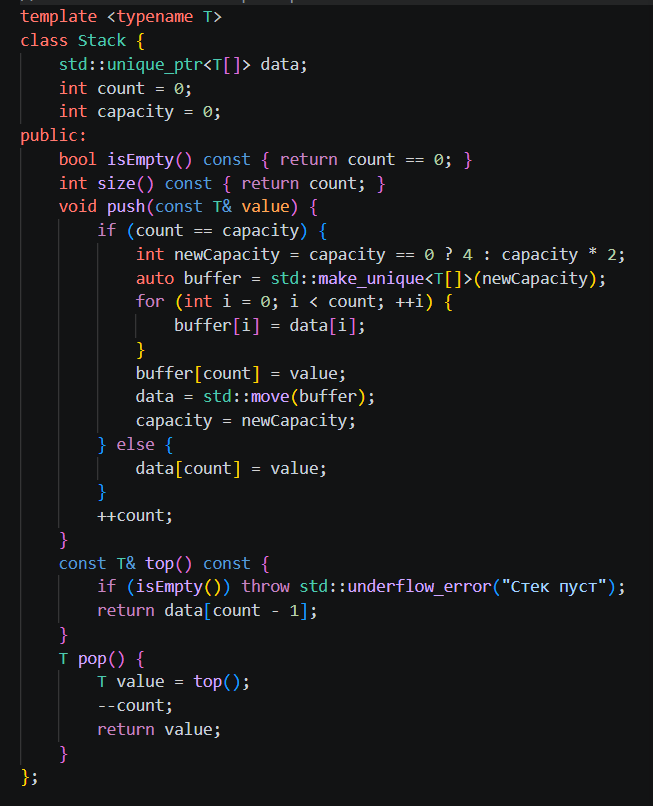
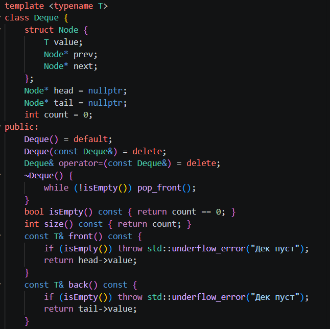
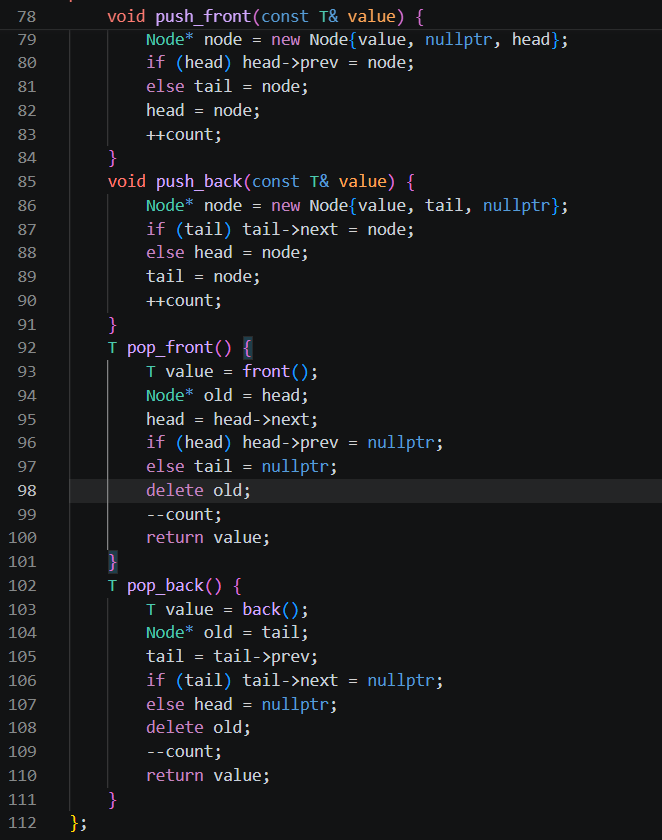
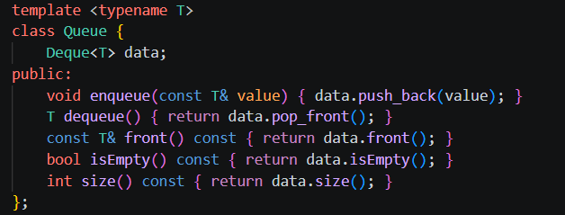
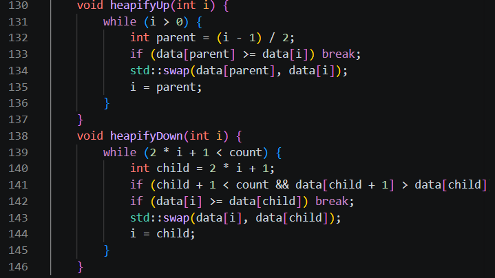
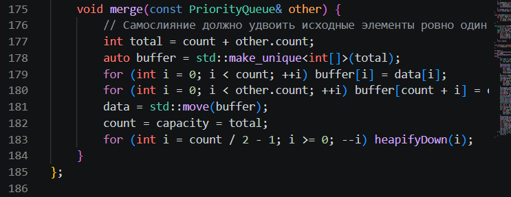
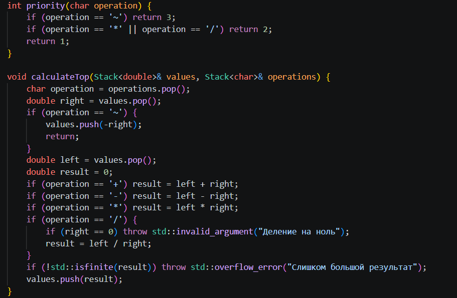
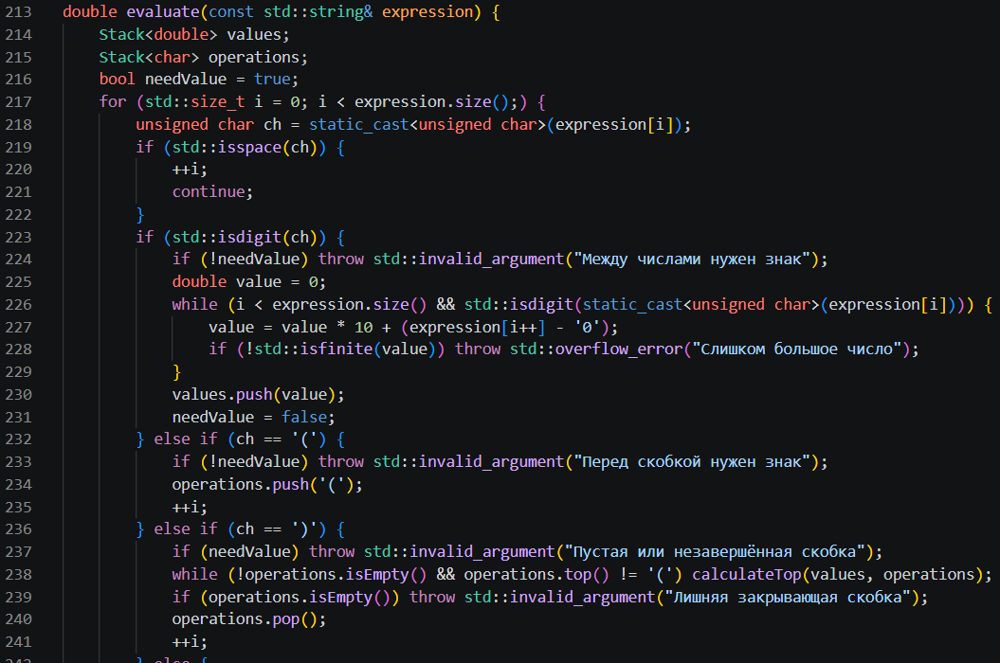
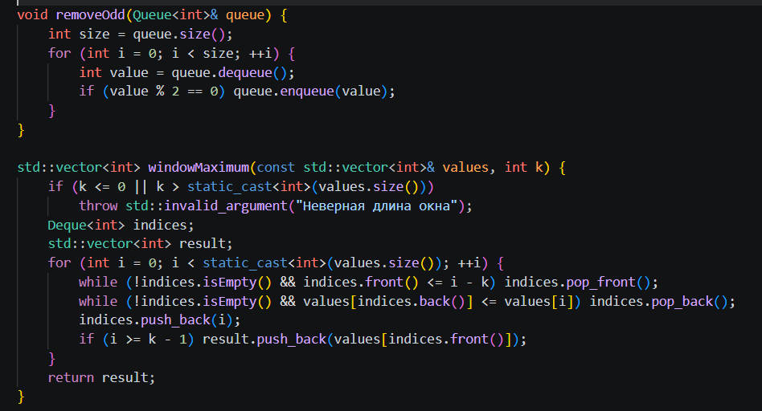
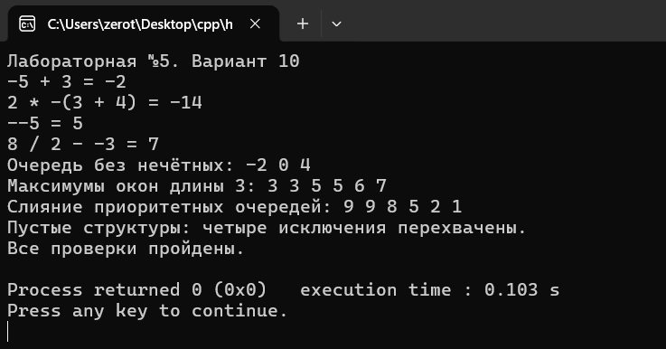

# Лабораторная работа №5

**Дисциплина** — Алгоритмы и структуры данных  
**Тема** — Стек, очередь, дек, приоритетная очередь  
**Уровень** — Единые задания на 100 баллов  
**Вариант** — №10  
**Выполнил** — Саакян Аргишти Самвелович  
**Группа** — ПИЖ-б-о-25-2 (2)

## 1. Цель работы

Реализовать четыре структуры и применить каждую к задаче варианта №10.

## 2. Задание

Стек — вычислить выражение с унарным минусом. Очередь — удалить нечётные элементы. Дек — найти максимумы окон длины k. Приоритетная очередь — реализовать merge двух очередей.

## 3. Краткая теория

Стек работает по LIFO, очередь по FIFO, дек разрешает операции с обоих концов. У максимальной кучи родитель не меньше потомков, поэтому корень хранит максимум.

## 4. Ход выполнения работы

Исходный файл — [main.cpp](main.cpp).

### 4.1. Собственный стек

При заполнении буфера ёмкость удваивается. top читает последний элемент, pop уменьшает размер. unique_ptr освобождает массив.



**Рисунок 1 - Собственный стек.**

### 4.2. Узлы дека и границы

head и tail обозначают концы двусвязного списка. Чтение из пустого дека вызывает исключение.



**Рисунок 2 - Узлы дека и границы.**

### 4.3. Операции на концах дека

Обновляются соседние ссылки и границы. При удалении единственного узла head и tail становятся nullptr.



**Рисунок 3 - Операции на концах дека.**

### 4.4. Очередь на собственном деке

enqueue добавляет сзади, dequeue извлекает спереди. Класс использует нашу реализацию узлов.



**Рисунок 4 - Очередь на собственном деке.**

### 4.5. Восстановление кучи

heapifyUp поднимает новое значение к родителю, heapifyDown спускает значение к большему ребёнку.



**Рисунок 5 - Восстановление кучи.**

### 4.6. Слияние двух куч

Оба массива копируются в один буфер. Куча строится снизу вверх за O(n + m). Второй объект сохраняется, самослияние удваивает элементы.



**Рисунок 6 - Слияние двух куч.**

### 4.7. Приоритет и выполнение операции

Унарный минус обозначен ~ и имеет высший приоритет. Для бинарной операции сначала снимается правый операнд, затем левый.



**Рисунок 7 - Приоритет и выполнение операции.**

### 4.8. Разбор выражения двумя стеками

Один стек хранит числа, другой операции. Флаг needValue отличает унарный минус от бинарного. Скобки ограничивают свёртку. Длинный блок можно снять двумя последовательными кадрами и объединить.



**Рисунок 8 - Разбор выражения двумя стеками.**

### 4.9. Удаление нечётных и скользящее окно

Очередь обрабатывается исходное число раз. Дек окна хранит индексы по убыванию значений, просроченные и бесполезные индексы удаляются.



**Рисунок 9 - Удаление нечётных и скользящее окно.**

## 5. Анализ сложности

| Операция | Время / память | Обоснование |
|---|---|---|
| Стек: push; pop, top, size, isEmpty | O(1) амортизированно; O(1) | Отдельное расширение O(n). |
| Очередь и дек: операции на концах | O(1) | Ограниченное число ссылок. |
| Деструктор дека и очереди | O(n) | Освобождаются все узлы. |
| Куча: push, pop; top, size, isEmpty | O(log n); O(1) | push амортизированно O(log n), при расширении O(n). |
| merge | O(n + m) | Копирование и построение кучи. |
| Вычисление выражения | O(L) | Каждая операция снимается со стека один раз. |
| Удаление нечётных | O(n) | Один проход. |
| Максимумы окон | O(n) | Индекс добавляется и удаляется не более одного раза. |

## 6. Сборка и результаты

Команды PowerShell из папки работы. Используется C++17, как в предыдущих лабораторных.

```powershell
g++ -std=c++17 -O2 -Wall -Wextra -Wpedantic -finput-charset=UTF-8 -fexec-charset=UTF-8 -static main.cpp -o lab5.exe
if ($LASTEXITCODE -eq 0) { .\lab5.exe }
```

Контрольная сборка выполнена GCC 14.2.0 под Windows с перечисленными предупреждениями и дополнительным флагом -Werror. Все программы завершились успешно.

| Вход / действие | Ожидаемый результат | Проверено |
|---|---|---|
| -5 + 3; 2 * -(3 + 4) | -2; -14 | Совпало |
| --5; 8 / 2 - -3 | 5; 7 | Совпало |
| Пустое выражение, 1/0, неверные скобки | Ошибки | Перехвачены |
| Очередь -3 -2 0 1 4 7 | -2 0 4 | Совпало |
| Окна длины 3 для 1 3 -1 -3 5 3 6 7 | 3 3 5 5 6 7 | Совпало |
| Слияние 5 1 9 и 8 2 9 | 9 9 8 5 2 1 | Совпало |
| Извлечение из четырёх пустых структур | Четыре исключения | Перехвачены |
| 5000 случайных операций и окна разных длин | Совпадение с независимыми эталонами | Проверено |

### 6.1. Результаты и методика

Стек и куча используют свои массивы через unique_ptr, дек — свои двусвязные узлы. Queue использует собственный Deque. Стандартный vector используется для входа и результата задачи об окне. Копирование дека запрещено, память освобождается его деструктором.



**Рисунок 10 - Результаты запуска программы.**

### 6.3. Особенности реализации

Вход выражения содержит целые записи чисел, пробелы, скобки и + - * /. Поддерживаются унарные знаки. Вычисления идут в double, поэтому деление может дать дробный результат. Литералы с десятичной точкой в этом варианте не предусмотрены. Очень большие значения ограничены точностью double.

## 7. Ответы на контрольные вопросы

1. **В чём заключается принцип работы стека (LIFO)?** LIFO означает, что первым извлекается последний добавленный элемент, как у стопки тарелок.

2. **В чём заключается принцип работы очереди (FIFO)?** FIFO означает, что первым извлекается самый ранний добавленный элемент. Добавление идёт в хвост, извлечение — из головы.

3. **Чем дек отличается от обычной очереди?** Дек разрешает добавление и удаление с обоих концов. Очередь добавляет сзади и извлекает спереди.

4. **Что такое приоритетная очередь? Где она применяется?** Приоритетная очередь извлекает элемент с наибольшим или наименьшим приоритетом. Это полезно для планировщиков и обработки событий.

5. **Как реализовать стек на основе динамического массива?** Хранят буфер, размер и ёмкость. При заполнении выделяют больший буфер, pop уменьшает размер.

6. **Как реализовать очередь на основе кольцевого буфера?** Хранят индекс головы и число элементов. Позиции вычисляют по модулю ёмкости, чтобы повторно использовать освобождённые ячейки.

7. **Почему приоритетную очередь обычно реализуют на куче?** Куча хранит экстремум в корне и восстанавливает порядок вдоль пути высоты O(log n).

8. **Какова сложность операций push и pop в стеке?** В массивном стеке push стоит O(1) амортизированно и O(n) при расширении. pop и top — O(1).

9. **Какова сложность операций enqueue и dequeue в очереди?** Очередь с головой и хвостом даёт O(1). У расширяемого кольцевого массива вставка O(1) амортизированно.

10. **Какова сложность операций в приоритетной очереди? Почему?** Подъём и спуск занимают O(log n), чтение корня — O(1). Отдельное расширение буфера добавляет O(n).

11. **Как проверить правильность расстановки скобок с помощью стека?** Открывающие скобки помещаются в стек. Для закрывающей проверяют соответствие вершине. После обработки стек должен быть пуст.

12. **Как реализовать очередь на двух стеках? Какова сложность?** Новые значения идут в первый стек. Когда второй пуст, в него перекладывают первый. Каждый элемент переносится один раз, поэтому операции O(1) амортизированно.

13. **Как реализовать дек на основе двусвязного списка?** Узлы хранят next и prev, а дек — head и tail. Операция на конце меняет ограниченное число ссылок.

14. **Как реализовать дек на основе кольцевого буфера?** Хранят буфер, индекс начала и размер. При вставке спереди индекс уменьшают по модулю ёмкости, сзади используют позицию после последнего.

15. **Как реализовать стек с поддержкой получения минимума за O(1)?** Второй стек хранит текущие минимумы. Он обновляется при push и pop, поэтому getMin читает вершину за O(1).

## 8. Вывод

В ходе работы я реализовал требуемые операции и проверил их на обычных и граничных примерах. Получены правильные результаты четырёх задач. Слияние выполняется за линейное время, а монотонный дек позволяет найти максимумы окон за один проход.

[Git-репозиторий с лабораторными](https://github.com/sakiriyan/saakian-cpp-lab)
