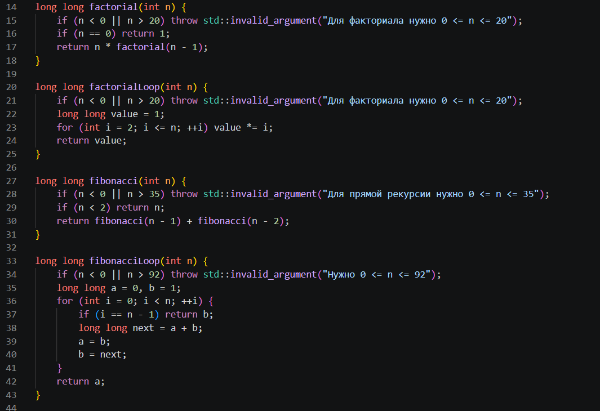
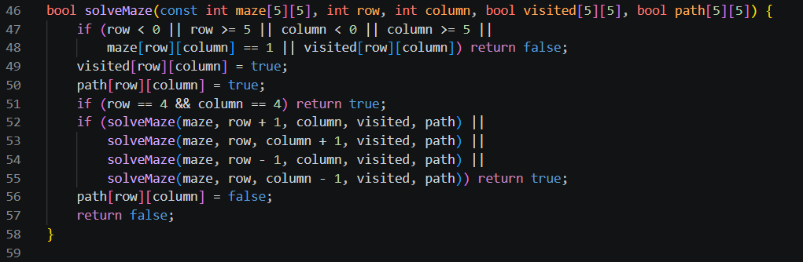
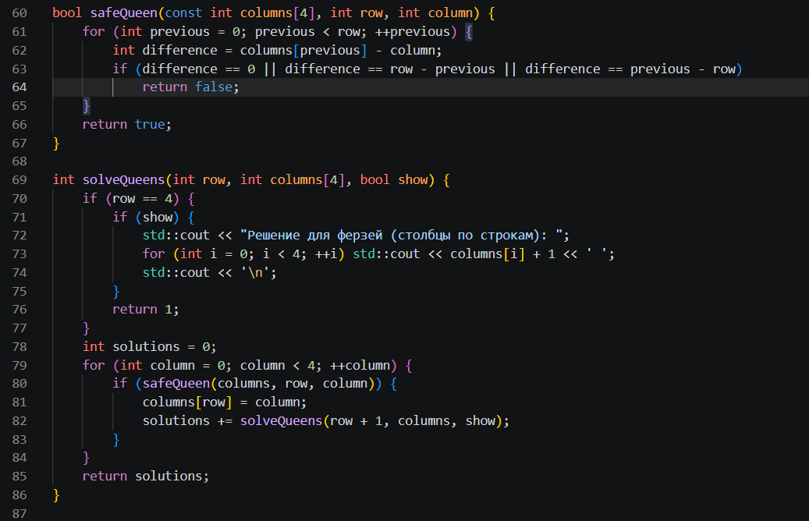
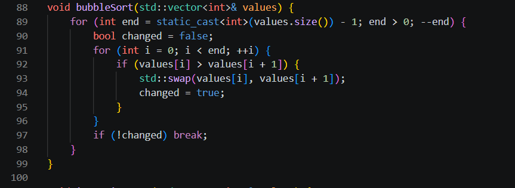
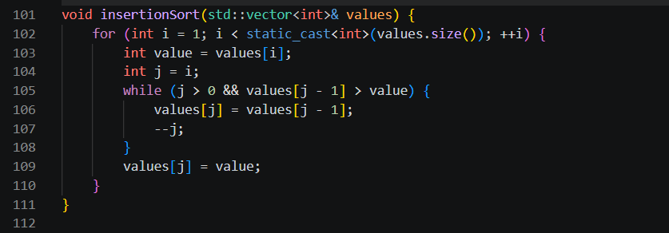
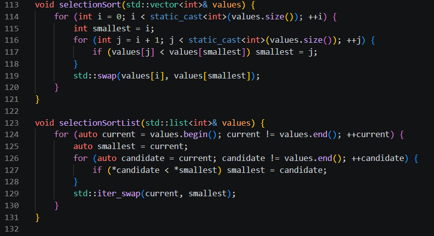
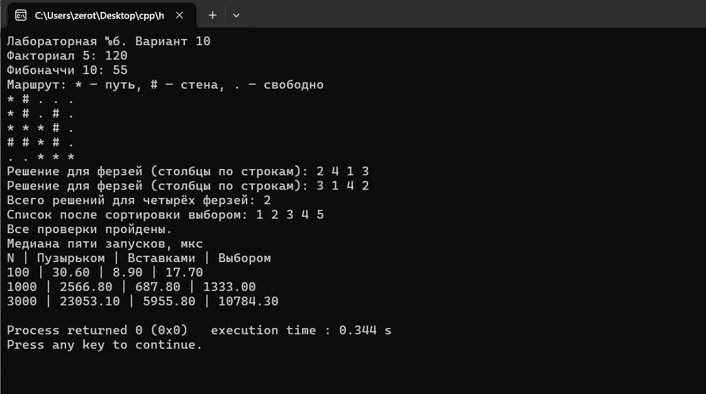

# Лабораторная работа №6

**Дисциплина** — Алгоритмы и структуры данных  
**Тема** — Рекурсивные алгоритмы. Простые сортировки  
**Уровень** — Единые задания на 100 баллов  
**Вариант** — №10  
**Выполнил** — Саакян Аргишти Самвелович  
**Группа** — ПИЖ-б-о-25-2 (2)

## 1. Цель работы

Решить рекурсивные задачи и сравнить три простые сортировки.

## 2. Задание

Вариант №10 — факториал, Фибоначчи, лабиринт 5×5, четыре ферзя на поле 4×4. Пузырьковая сортировка, вставки, выбор и сортировка выбором связного списка.

## 3. Краткая теория

Рекурсия завершается базовым случаем. Поиск с возвратом пробует продолжения и отменяет неудачный шаг. Простые сортировки в худшем случае выполняются за O(n²).

## 4. Ход выполнения работы

Исходный файл — [main.cpp](main.cpp).

### 4.1. Факториал и Фибоначчи

Рекурсивные функции имеют базовые случаи. Итеративные версии используются для проверки тех же результатов.



**Рисунок 1 - Факториал и Фибоначчи.**

### 4.2. Поиск пути в лабиринте

Границы, стены и visited отсекают недопустимые шаги. path отмечает текущий маршрут и снимается при неудаче.



**Рисунок 2 - Поиск пути в лабиринте.**

### 4.3. Расстановка четырёх ферзей

Для строки перебираются столбцы, а прежние ферзи проверяются по столбцам и диагоналям. Заполненная доска даёт одно решение.



**Рисунок 3 - Расстановка четырёх ферзей.**

### 4.4. Пузырьковая сортировка

Соседние неверно расположенные значения меняются местами. Проход без обменов завершает сортировку.



**Рисунок 4 - Пузырьковая сортировка.**

### 4.5. Сортировка вставками

Очередное значение сохраняется, большие значения сдвигаются вправо. В освободившуюся позицию записывается сохранённое.



**Рисунок 5 - Сортировка вставками.**

### 4.6. Выбор минимума в массиве и списке

Для каждой позиции ищется минимум оставшейся части. В связном списке используются итераторы и iter_swap значений узлов.



**Рисунок 6 - Выбор минимума в массиве и списке.**

## 5. Анализ сложности

| Операция | Время / память | Обоснование |
|---|---|---|
| Факториал: рекурсия и цикл | O(n) | Память рекурсии O(n), цикла O(1). |
| Фибоначчи: прямая рекурсия | O(2ⁿ) сверху | Глубина стека O(n). |
| Фибоначчи: цикл | O(n) | Дополнительная память O(1). |
| Лабиринт | O(V + E) | Каждая клетка посещается один раз, на решётке E = O(V). |
| Ферзи | O(n · n!) сверху | Перебор размещений и проверка до n прежних строк; здесь n = 4. |
| Пузырьком и вставками | O(n²), лучший O(n) | Флаг остановки или малое число сдвигов. |
| Выбором: массив и список | O(n²) | Повторный поиск минимума. |

## 6. Сборка и результаты

Команды PowerShell из папки работы. Используется C++17, как в предыдущих лабораторных.

```powershell
g++ -std=c++17 -O2 -Wall -Wextra -Wpedantic -finput-charset=UTF-8 -fexec-charset=UTF-8 -static main.cpp -o lab6.exe
if ($LASTEXITCODE -eq 0) { .\lab6.exe }
```

Контрольная сборка выполнена GCC 14.2.0 под Windows с перечисленными предупреждениями и дополнительным флагом -Werror. Все программы завершились успешно.

| Вход / действие | Ожидаемый результат | Проверено |
|---|---|---|
| Факториал 5; Фибоначчи 10 | 120; 55 | Совпало |
| Факториал 0…20, Фибоначчи 0…20 | Рекурсия равна циклу | Проверено |
| Лабиринт и стена на выходе | Путь есть; пути нет | Проверено |
| Поле 4×4 | Два решения: 2 4 1 3 и 3 1 4 2 | Совпало |
| Пустые, одиночные, обратные, случайные данные и повторы | Как std::sort | Массивы и список совпали |
| Факториал -1, 21 и Фибоначчи -1 | Недопустимый аргумент | Исключения перехвачены |

### 6.1. Результаты и методика

Для N = 100, 1000, 3000 используется один случайный исходный массив. Копирование выполняется вне таймера. Таблица содержит медиану пяти запусков сортировки в мкс. Результаты сверяются со std::sort. Рекурсивный Фибоначчи ограничен n <= 35 для разумного времени; итеративный вычисляет до F92.

Контрольные измерения при подготовке работы.

| N | Пузырьком, мкс | Вставками, мкс | Выбором, мкс |
|---|---|---|---|
| 100 | 12.80 | 1.30 | 4.10 |
| 1000 | 1323.00 | 69.10 | 221.10 |
| 3000 | 12322.60 | 586.10 | 1659.50 |

Время повторного запуска может отличаться. Для согласованной сдачи перенеси в таблицу числа своего запуска, показанные на снимке консоли.



**Рисунок 7 - Результаты запуска программы.**

### 6.3. Особенности реализации

В лабиринте ищется один допустимый маршрут. visited сохраняет посещённые клетки, path снимает неудачные участки. Сортировка списка переставляет значения существующих узлов.

## 7. Ответы на контрольные вопросы

1. **Что такое рекурсия? Из каких компонентов состоит рекурсивная функция?** Рекурсивная функция вызывает себя для меньшей подзадачи. Нужны базовый случай и шаг, приближающий к нему.

2. **Что такое базовый случай рекурсии? Почему он важен?** Это условие возврата готового ответа без нового вызова. Оно останавливает рекурсию до переполнения стека.

3. **Чем отличается прямая рекурсия от косвенной?** Прямая функция вызывает себя, косвенная рекурсия проходит через несколько функций.

4. **Что такое хвостовая рекурсия? В чём её преимущество?** В хвостовой рекурсии вызов является последним действием. Компилятор иногда заменяет его циклом, но C++ не гарантирует такую оптимизацию.

5. **Какова временная сложность рекурсивного вычисления чисел Фибоначчи? Почему?** Время экспоненциальное, верхняя оценка O(2ⁿ). Вызовы для n - 1 и n - 2 порождают много повторных вычислений.

6. **Как можно оптимизировать рекурсивное вычисление Фибоначчи?** Запоминать результаты или считать в цикле. Цикл требует O(n) времени и O(1) дополнительной памяти.

7. **В чём отличие рекурсивной реализации от итеративной?** Рекурсия хранит состояние в кадрах вызовов. Итерация явно обновляет переменные и часто экономит память.

8. **Какова сложность пузырьковой сортировки? Когда она становится O(n)?** Среднее и худшее время O(n²). С флагом обменов уже упорядоченный массив обрабатывается за O(n).

9. **Чем сортировка вставками отличается от сортировки выбором?** Вставки размещают очередной элемент в упорядоченном префиксе. Выбор находит минимум в оставшемся суффиксе.

10. **Какая из простых сортировок является устойчивой? Что это значит?** Пузырьковая и вставки устойчивы при корректном сравнении равных значений. Устойчивость сохраняет порядок записей с равными ключами.

11. **Какая из простых сортировок работает лучше на почти отсортированных данных?** Вставки часто эффективнее, потому что на почти готовом массиве нужно мало сдвигов. Лучшее время O(n).

12. **Как реализовать пузырьковую сортировку с оптимизацией?** Нужно запоминать наличие обмена за проход. После прохода без обменов можно завершить сортировку.

13. **Что такое рекурсивный поиск с возвратом (backtracking)?** Поиск с возвратом пробует очередной шаг и отменяет его при неудаче. Так перебираются безопасные позиции ферзей.

14. **Как рекурсивно обойти лабиринт?** Проверить границы, стену и посещённость, отметить клетку, рекурсивно попробовать соседей. Неудачный путь снимается при возврате.

15. **Какова сложность Ханойских башен? Сколько ходов нужно для перемещения n дисков?** Нужно 2ⁿ − 1 ходов. Время O(2ⁿ), поскольку задача дважды сводится к переносу n − 1 диска.

## 8. Вывод

В ходе работы я реализовал требуемые операции и проверил их на обычных и граничных примерах. Рекурсивный поиск нашёл маршрут, а перебор ферзей перечислил оба решения. Вставки в контрольном запуске были быстрее остальных простых сортировок.

[Git-репозиторий с лабораторными](https://github.com/sakiriyan/saakian-cpp-lab)
