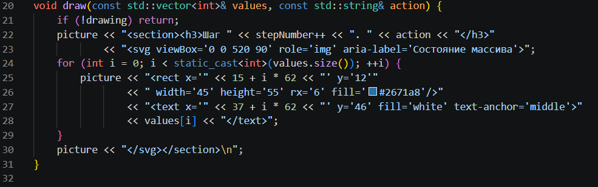
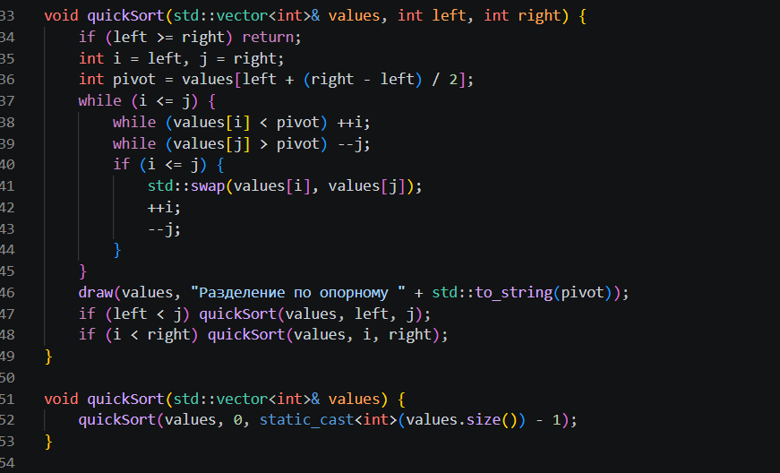
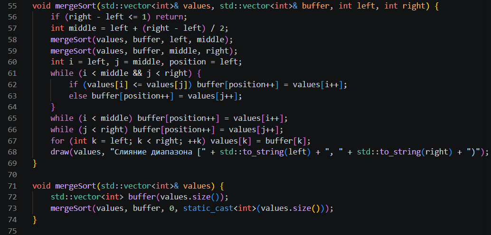
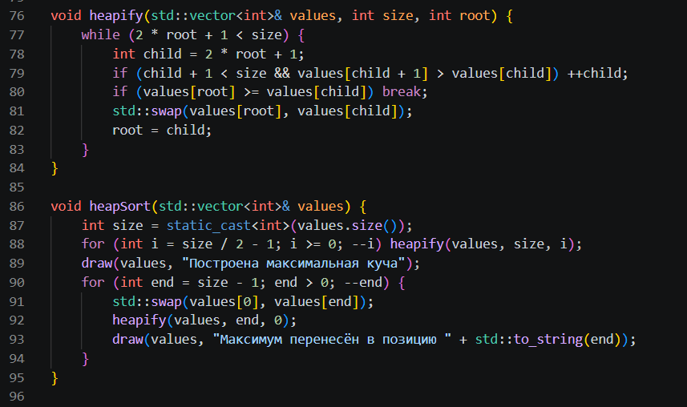
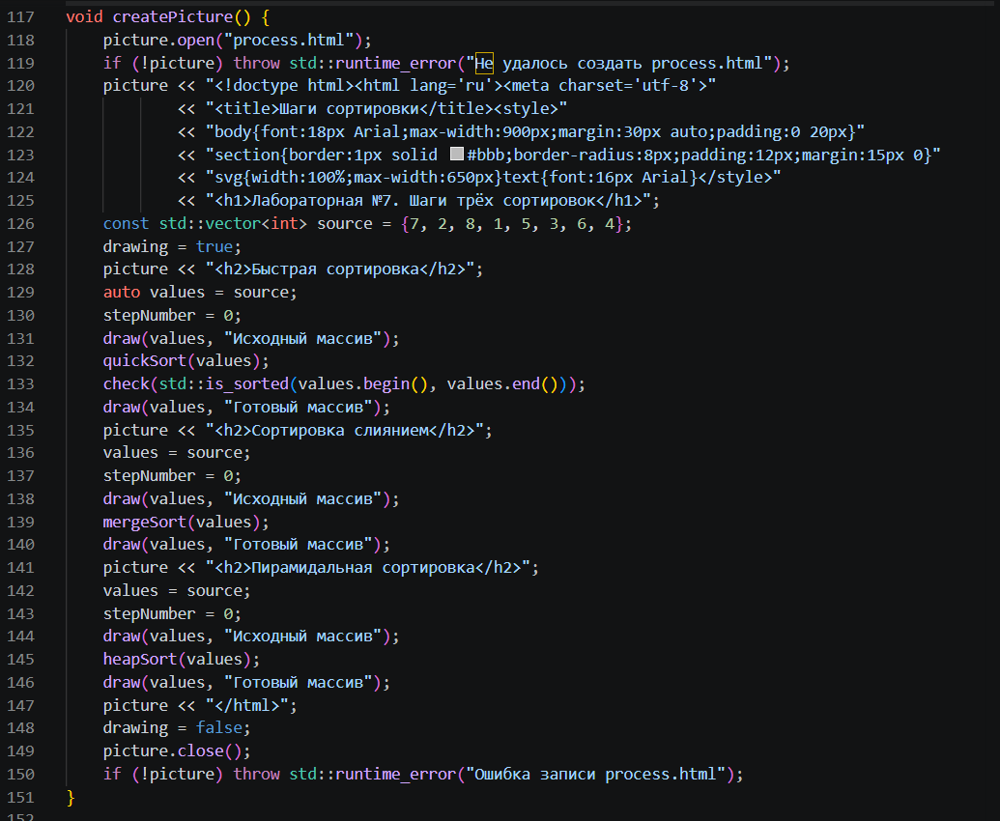
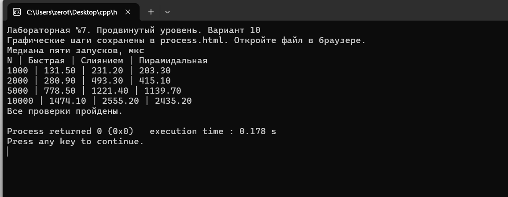

# Лабораторная работа №7

**Дисциплина** — Алгоритмы и структуры данных  
**Тема** — Быстрая сортировка, сортировка слиянием и пирамидальная сортировка  
**Уровень** — Продвинутый  
**Вариант** — №10  
**Выполнил** — Саакян Аргишти Самвелович  
**Группа** — ПИЖ-б-о-25-2 (2)

## 1. Цель работы

Реализовать три эффективные сортировки, сравнить время и показать изменения массива.

## 2. Задание

Вариант №10 — все три сортировки, сравнение на случайных данных и графическая визуализация процесса. Размеры измерений 1000, 2000, 5000, 10000.

## 3. Краткая теория

Быстрая сортировка делит данные по опоре, слияние соединяет отсортированные половины, пирамидальная извлекает максимумы из двоичной кучи.

## 4. Ход выполнения работы

Исходный файл — [main.cpp](main.cpp).

### 4.1. Графическое состояние массива

Числа изображаются одинаковыми цветными ячейками. Снимки формируются из фактических состояний массива после шагов алгоритма.



**Рисунок 1 - Графическое состояние массива.**

### 4.2. Быстрая сортировка

Опора берётся из средней позиции. Два индекса движутся навстречу и меняют неправильно расположенные значения.



**Рисунок 2 - Быстрая сортировка.**

### 4.3. Сортировка слиянием

Диапазон делится до единичных частей. При слиянии равных значений выбирается левое, поэтому алгоритм устойчив.



**Рисунок 3 - Сортировка слиянием.**

### 4.4. Пирамидальная сортировка

heapify спускает значение к большему ребёнку. Максимум переносится в конец неотсортированной части.



**Рисунок 4 - Пирамидальная сортировка.**

### 4.5. Запись шагов в HTML

Один массив из восьми чисел сортируется каждым алгоритмом. Файл process.html показывает состояния ячеек от исходного до готового массива.



**Рисунок 5 - Запись шагов в HTML.**

## 5. Анализ сложности

| Операция | Время / память | Обоснование |
|---|---|---|
| Быстрая | O(n log n) в среднем, O(n²) в худшем | Стек O(log n) в среднем, O(n) в худшем. |
| Слиянием | O(n log n) | Буфер O(n), стек O(log n). |
| Построение кучи | O(n) | Восстановление снизу вверх. |
| Пирамидальная | O(n log n) | Итеративный heapify, дополнительная память O(1). |
| Один графический снимок | O(n) | Для каждой ячейки записываются прямоугольник и число. |

## 6. Сборка и результаты

Команды PowerShell из папки работы. Используется C++17, как в предыдущих лабораторных.

```powershell
g++ -std=c++17 -O2 -Wall -Wextra -Wpedantic -finput-charset=UTF-8 -fexec-charset=UTF-8 -static main.cpp -o lab7.exe
if ($LASTEXITCODE -eq 0) { .\lab7.exe }
```

Контрольная сборка выполнена GCC 14.2.0 под Windows с перечисленными предупреждениями и дополнительным флагом -Werror. Все программы завершились успешно.

| Вход / действие | Ожидаемый результат | Проверено |
|---|---|---|
| Пустой и одноэлементный массив | Без изменений | Проверено |
| Прямой и обратный порядок | Возрастание | Как std::sort |
| Повторы и отрицательные числа | Правильный порядок и состав | Как std::sort |
| Случайные массивы длины 0…199 | Как std::sort | Все три алгоритма совпали |
| 7 2 8 1 5 3 6 4 | 1 2 3 4 5 6 7 8 в финале | Шаги записаны в HTML |

### 6.1. Результаты и методика

Для каждого N используется одинаковый исходный случайный массив. Измеряется сортировка копии, таблица содержит медиану пяти запусков в мкс. Генератор инициализирован числом 42. Запись HTML отключена во всех измерениях и включается для отдельной маленькой демонстрации.

Контрольные измерения при подготовке работы.

| N | Быстрая, мкс | Слиянием, мкс | Пирамидальная, мкс |
|---|---|---|---|
| 1000 | 76.60 | 137.50 | 85.20 |
| 2000 | 168.90 | 275.00 | 181.10 |
| 5000 | 464.30 | 724.30 | 501.20 |
| 10000 | 845.00 | 1482.90 | 959.70 |

Время повторного запуска может отличаться. Для согласованной сдачи перенеси в таблицу числа своего запуска, показанные на снимке консоли.

### 6.2. Графическая визуализация

После запуска программа создаёт файл process.html в текущей папке. Открой файл в браузере. В ячейках показаны исходный массив и последовательность состояний каждого алгоритма. Начальный порядок 7 2 8 1 5 3 6 4, итоговый — 1 2 3 4 5 6 7 8.



**Рисунок 7 - Результаты запуска программы.**

### 6.3. Особенности реализации

График времени по выбранному формату исключён, таблица сохранена. В среднем уровне варианта 10 график указан отдельно. Графическая визуализация продвинутого задания сохранена — последовательность состояний массива в process.html.

## 7. Ответы на контрольные вопросы

1. **Какова сложность быстрой сортировки в лучшем, среднем и худшем случае?** Лучшее и среднее время O(n log n), худшее — O(n²), когда разбиения очень неравномерны.

2. **Когда возникает худший случай для быстрой сортировки?** Если опорное значение постоянно отделяет слишком маленькую часть. Например, крайняя опора опасна на упорядоченном массиве.

3. **Как можно улучшить быструю сортировку для защиты от худшего случая?** Выбирать случайную опору или медиану трёх, ограничить глубину рекурсии с переходом на heapsort. Здесь взят элемент средней позиции.

4. **Какова сложность сортировки слиянием? Почему она всегда O(n log n)?** На O(log n) уровнях выполняется суммарно O(n) работы слияния, поэтому O(n log n).

5. **Какие преимущества и недостатки имеет сортировка слиянием перед быстрой?** Слияние гарантирует O(n log n) и устойчивость, но массивная версия требует буфер O(n). Быстрая обычно требует меньше дополнительной памяти.

6. **Как работает пирамидальная сортировка? Какова её сложность?** Строится максимальная куча. Корень переносится в конец, затем куча восстанавливается. Время O(n log n).

7. **Какая из трёх сортировок устойчивая? Почему?** Слияние устойчиво, если при равенстве берётся левая запись. Обычные быстрая и пирамидальная версии меняют порядок равных ключей.

8. **Какая из трёх сортировок требует дополнительной памяти? Сколько?** Слияние требует O(n) для буфера. Быстрая использует рекурсивный стек в среднем O(log n), в худшем O(n). Итеративная heapsort требует O(1).

9. **Какая из трёх сортировок лучше работает на почти отсортированных данных?** Результат зависит от реализации. Быстрая с опорой из середины обычно сохраняет O(n log n). Для маленьких почти готовых массивов подходят вставки.

10. **Зачем в пирамидальной сортировке сначала строится куча?** Куча позволяет получать максимум в корне. Её построение O(n), а каждое последующее восстановление O(log n).

11. **Что такое «разделяй и властвуй»? Как он применяется в быстрой сортировке и сортировке слиянием?** Большая задача разбивается на меньшие. Быстрая делит по опоре, слияние сортирует половины и соединяет их.

12. **Можно ли реализовать быструю сортировку итеративно (без рекурсии)?** Да, границы необработанных диапазонов можно хранить в явном стеке и извлекать их в цикле.

13. **Почему быстрая сортировка обычно быстрее сортировки слиянием на практике?** Часто помогают локальность и небольшие накладные расходы. Преимущество зависит от входа, реализации и оборудования.

14. **Когда выгодно использовать пирамидальную сортировку?** Когда нужны гарантированный O(n log n) и малая дополнительная память.

15. **Какой алгоритм сортировки вы бы выбрали для встроенных систем с ограниченной памятью?** При жёстком ограничении памяти — итеративная пирамидальная. Для маленького массива можно рассмотреть вставки.

## 8. Вывод

В ходе работы я реализовал требуемые операции и проверил их на обычных и граничных примерах. Все алгоритмы дали одинаковый отсортированный результат. На N = 10000 в контрольном запуске быстрая была быстрее остальных.

[Git-репозиторий с лабораторными](https://github.com/sakiriyan/saakian-cpp-lab)
