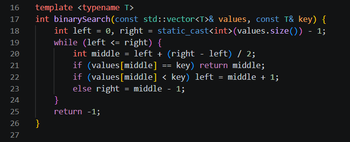
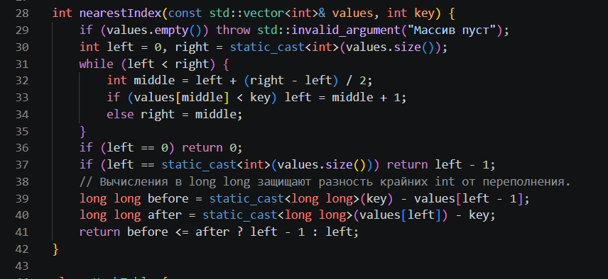
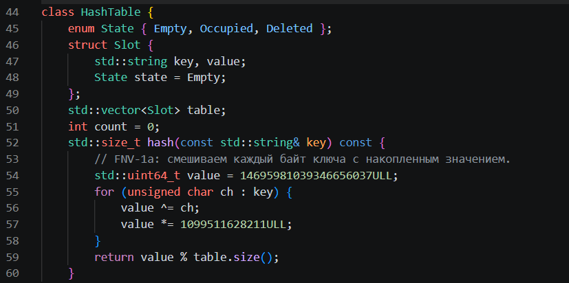
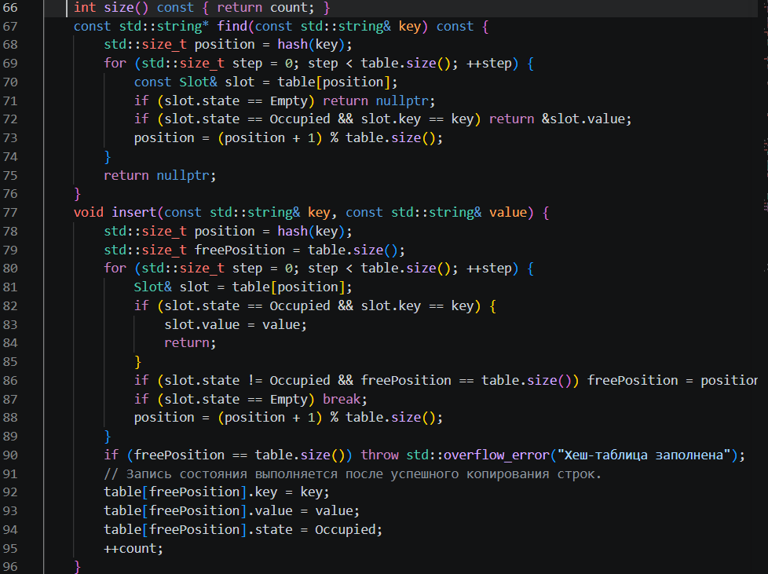
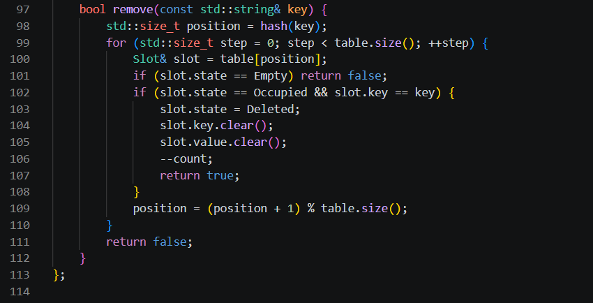
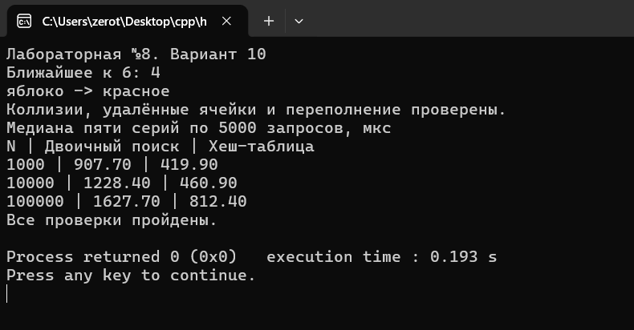

# Лабораторная работа №8

**Дисциплина** — Алгоритмы и структуры данных  
**Тема** — Двоичный поиск. Хеш-таблицы  
**Уровень** — Единые задания на 100 баллов  
**Вариант** — №10  
**Выполнил** — Саакян Аргишти Самвелович  
**Группа** — ПИЖ-б-о-25-2 (2)

## 1. Цель работы

Найти ближайший элемент бинарным поиском, реализовать хеш-таблицу и сравнить поиск.

## 2. Задание

Вариант №10 — ближайшее к заданному целое значение, таблица string → string с линейным пробированием. Сравнить поиск при N = 1000, 10000, 100000.

## 3. Краткая теория

Бинарный поиск требует упорядоченного массива. Хеш-таблица вычисляет начальную ячейку, при коллизии пробует следующую. Удалённая ячейка отличается от никогда не занятой, чтобы сохранялся путь поиска.

## 4. Ход выполнения работы

Исходный файл — [main.cpp](main.cpp).

### 4.1. Итеративный двоичный поиск

На каждом шаге диапазон уменьшается вдвое. При отсутствии возвращается -1. Шаблон применён к числам и строкам.



**Рисунок 1 - Итеративный двоичный поиск.**

### 4.2. Ближайшее значение

Находится первая позиция не меньше ключа. Среди соседей выбирается ближайший; при равном расстоянии — меньшее значение.



**Рисунок 2 - Ближайшее значение.**

### 4.3. Ячейки и хеш-функция

Ячейка хранит ключ, значение и статус. FNV-1a смешивает байты строки через XOR и умножение. Остаток по ёмкости задаёт начальный индекс.



**Рисунок 3 - Ячейки и хеш-функция.**

### 4.4. Поиск и вставка с пробированием

Поиск пропускает Deleted. Вставка запоминает свободное место, но проверяет последующие записи, чтобы повторный ключ обновился.



**Рисунок 4 - Поиск и вставка с пробированием.**

### 4.5. Удаление ключа

Статус Deleted позволяет найти другие ключи, которые ранее сдвинулись из-за коллизии. Поиск останавливается на Empty или после полного круга.



**Рисунок 5 - Удаление ключа.**

## 5. Анализ сложности

| Операция | Время / память | Обоснование |
|---|---|---|
| binarySearch, nearestIndex | O(log n) сравнений | Дополнительная память O(1). |
| Хеш строки длины L | O(L) | Обрабатывается каждый байт. |
| insert, find, remove | Ожидаемо O(1) проб, худшее O(m) | m — ёмкость; дополнительно учитываются длины строк. |
| Конструктор таблицы | O(m) | Инициализируется массив ячеек. |
| Память | O(m + S) | S — суммарная длина ключей и значений. |

## 6. Сборка и результаты

Команды PowerShell из папки работы. Используется C++17, как в предыдущих лабораторных.

```powershell
g++ -std=c++17 -O2 -Wall -Wextra -Wpedantic -finput-charset=UTF-8 -fexec-charset=UTF-8 -static main.cpp -o lab8.exe
if ($LASTEXITCODE -eq 0) { .\lab8.exe }
```

Контрольная сборка выполнена GCC 14.2.0 под Windows с перечисленными предупреждениями и дополнительным флагом -Werror. Все программы завершились успешно.

| Вход / действие | Ожидаемый результат | Проверено |
|---|---|---|
| 1 4 8 12, цель 6 | 4 при равном расстоянии | Совпало |
| За пределами диапазона, одна ячейка, INT_MIN и INT_MAX | Корректный ближайший | Проверено |
| Пустой массив | Исключение nearestIndex, -1 для binarySearch | Проверено |
| Повторный ключ яблоко | Обновление на красное без роста размера | Совпало |
| Коллизии a, d, h при ёмкости 3 | Поиск после удаления и повторное использование ячейки | Проверено |
| Полная таблица | Исключение для нового ключа | Перехвачено |
| 10000 случайных операций | Как std::map | Совпало |

### 6.1. Результаты и методика

Сравниваются одинаковые строковые ключи в отсортированном массиве и хеш-таблице. Ёмкость таблицы 2N + 1, загрузка около 0,5. Для N = 1000, 10000, 100000 выполняются пять серий по 5000 запросов, половина успешные. Таблица содержит медиану времени серии в мкс. Подготовка данных исключена.

Контрольные измерения при подготовке работы.

| N | Двоичный поиск, мкс / серия | Хеш-таблица, мкс / серия |
|---|---|---|
| 1000 | 322.30 | 116.00 |
| 10000 | 510.50 | 165.50 |
| 100000 | 1316.30 | 607.30 |

Время повторного запуска может отличаться. Для согласованной сдачи перенеси в таблицу числа своего запуска, показанные на снимке консоли.



**Рисунок 6 - Результаты запуска программы.**

### 6.3. Особенности реализации

nearestIndex требует отсортированный вход. При равном расстоянии выбирается меньшее значение. Ёмкость HashTable фиксируется в конструкторе; повторный ключ обновляется, заполнение вызывает исключение.

## 7. Ответы на контрольные вопросы

1. **Какое условие необходимо для применения двоичного поиска?** Массив должен быть отсортирован тем же правилом сравнения, которое использует поиск.

2. **Какова сложность двоичного поиска? Почему она логарифмическая?** O(log n), поскольку каждый шаг примерно вдвое сокращает диапазон.

3. **В чём разница между итеративной и рекурсивной реализацией двоичного поиска?** Итеративная версия обновляет границы в цикле и использует O(1) памяти, рекурсивная хранит O(log n) кадров вызовов.

4. **Чем опасен вариант mid = (left + right) / 2? Как правильно вычислять середину?** Сумма может переполниться. Используют left + (right - left) / 2 при допустимых границах.

5. **Что такое хеш-таблица? Из каких компонентов она состоит?** Это массив ячеек, хеш-функция и способ обработки коллизий. Хеш ключа задаёт начальную ячейку.

6. **Какие требования предъявляются к хеш-функции?** Детерминированность, быстрое вычисление и достаточно равномерное распределение ключей.

7. **Что такое коллизия в хеш-таблице? Как с ней бороться?** Разные ключи попали в одну начальную ячейку. Применяют цепочки или пробирование других позиций.

8. **В чём отличие метода цепочек от открытой адресации?** Цепочки хранят несколько записей в одном бакете. Открытая адресация помещает записи в другие ячейки общего массива.

9. **Что такое первичная и вторичная кластеризация?** Первичная кластеризация создаёт соседние занятые участки. Вторичная означает одинаковые последовательности проб для ключей с одной начальной позицией.

10. **Какова средняя и худшая сложность операций в хеш-таблице?** При хорошем распределении и умеренной загрузке — ожидаемо O(1) проб. В худшем O(n), для строк дополнительно учитывают их длину.

11. **Когда эффективнее использовать двоичный поиск, а когда - хеш- таблицу?** Бинарный поиск удобен в компактном уже упорядоченном массиве. Хеш-таблица подходит для частых запросов по точному ключу.

12. **Что такое коэффициент загрузки хеш-таблицы? Почему он важен?** Число записей, делённое на ёмкость. При высокой загрузке открытая адресация требует больше проб.

13. **Как работает рехеширование (динамическое расширение хеш- таблицы)?** Выделяют больший массив и заново вставляют записи с пересчётом индексов. Старые позиции напрямую копировать нельзя.

14. **Как выбрать размер хеш-таблицы? Почему часто выбирают простое число?** Размер берут с запасом по загрузке. Простое число может уменьшить регулярные совпадения у некоторых функций, но само по себе не гарантирует качество.

15. **Как реализовать хеш-функцию для строк?** Последовательно смешивают байты. Здесь FNV-1a выполняет XOR с байтом и умножение на константу, затем берётся остаток по ёмкости.

## 8. Вывод

В ходе работы я реализовал требуемые операции и проверил их на обычных и граничных примерах. В контрольном запуске хеш-таблица обрабатывала серии быстрее. У двоичного поиска время росло умеренно благодаря логарифмическому числу сравнений.

[Git-репозиторий с лабораторными](https://github.com/sakiriyan/saakian-cpp-lab)
