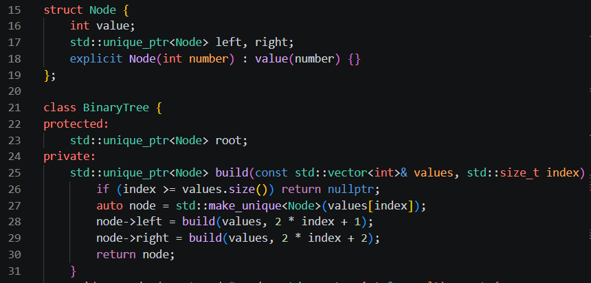
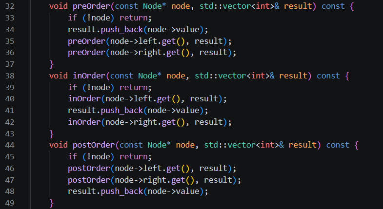
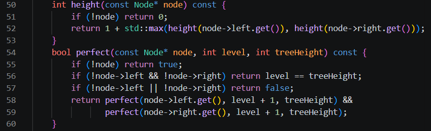
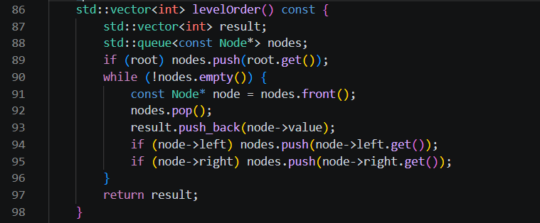
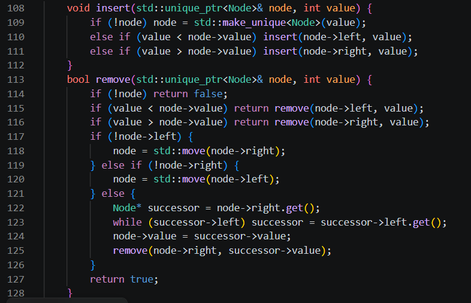
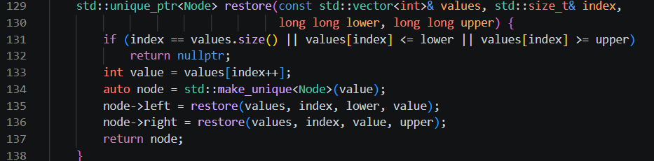
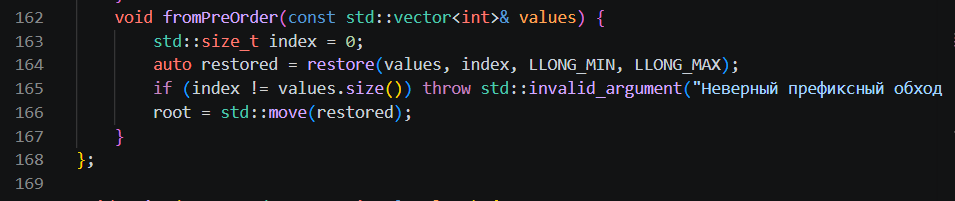
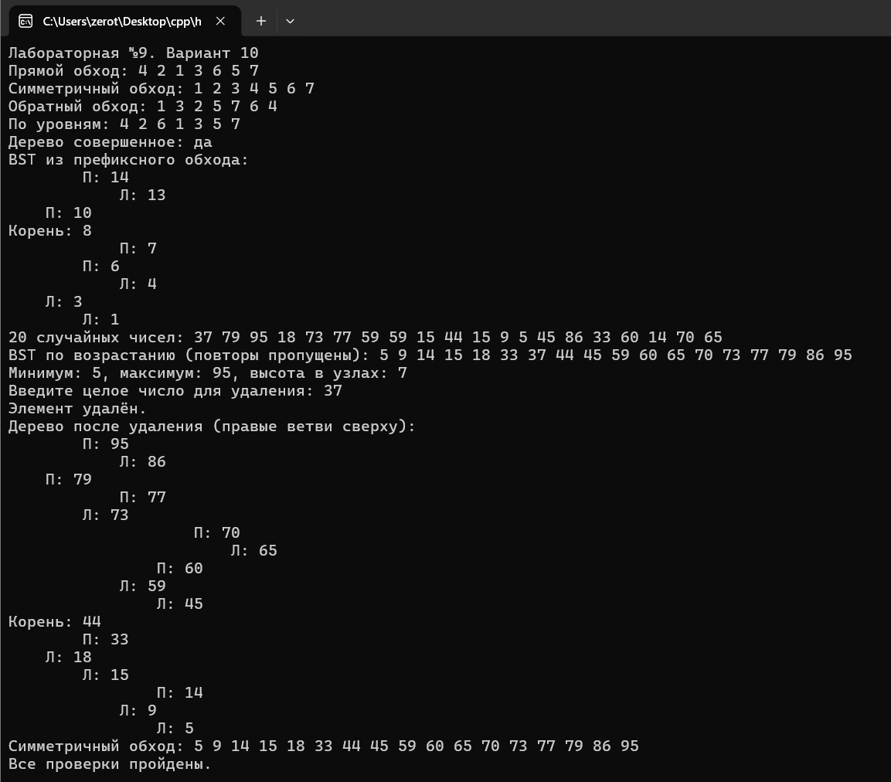

# Лабораторная работа №9

**Дисциплина** — Алгоритмы и структуры данных  
**Тема** — Бинарные деревья. Бинарное дерево поиска  
**Уровень** — Единые задания на 100 баллов  
**Вариант** — №10  
**Выполнил** — Саакян Аргишти Самвелович  
**Группа** — ПИЖ-б-о-25-2 (2)

## 1. Цель работы

Реализовать обходы и операции BST, проверить совершенность и восстановление из pre-order.

## 2. Задание

Вариант №10 — preOrder, inOrder, postOrder, levelOrder и проверка совершенного дерева. BST — insert, search, inOrder, remove и построение из pre-order. Общее задание — 20 случайных чисел, минимум, максимум, высота, удаление числа пользователя.

## 3. Краткая теория

В BST меньшие ключи находятся слева, большие справа. Совершенное дерево имеет двух детей у каждого внутреннего узла и все листья на одном уровне. Высота здесь считается в узлах.

## 4. Ход выполнения работы

Исходный файл — [main.cpp](main.cpp).

### 4.1. Узлы и построение дерева

Узел владеет потомками через unique_ptr. В массиве обхода по уровням дети индекса i расположены на 2i + 1 и 2i + 2.



**Рисунок 1 - Узлы и построение дерева.**

### 4.2. Три рекурсивных обхода

Место записи значения относительно рекурсивных вызовов определяет прямой, симметричный и обратный обходы.



**Рисунок 2 - Три рекурсивных обхода.**

### 4.3. Высота и проверка совершенности

У внутреннего узла проверяются оба ребёнка, а уровень листа должен совпадать с высотой.



**Рисунок 3 - Высота и проверка совершенности.**

### 4.4. Обход по уровням

Очередь хранит ожидающие узлы. После извлечения в неё добавляются левый и правый потомки.



**Рисунок 4 - Обход по уровням.**

### 4.5. Вставка и удаление BST

Лист или узел с одним потомком заменяется оставшимся поддеревом. При двух детях используется минимум правого поддерева.



**Рисунок 5 - Вставка и удаление BST.**

### 4.6. Восстановление из pre-order

Индекс идёт вперёд, для каждого поддерева задаются допустимые границы. Каждый ключ используется один раз.



**Рисунок 6 - Восстановление из pre-order.**

### 4.7. Проверка восстановленного дерева

Дерево сначала создаётся отдельно. Если часть входа не использована, выбрасывается исключение, прежний корень сохраняется.



**Рисунок 7 - Проверка восстановленного дерева.**

## 5. Анализ сложности

| Операция | Время / память | Обоснование |
|---|---|---|
| Обходы, height, isPerfect | O(n) | Просматривается каждый узел; isPerfect сначала определяет высоту. |
| insert, search, remove, minimum, maximum | O(h) | h = O(log n) у сбалансированного дерева и O(n) у цепочки. |
| Восстановление pre-order | O(n) | Каждый ключ читается один раз. |
| Стек рекурсивных функций | O(h) | Кадры для текущего пути. |
| Очередь обхода по уровням | O(w) | w — максимальная ширина. |
| Печать с отступами | До O(nh) символов | У глубоких узлов длиннее отступы. |
| Хранение и уничтожение | O(n) | Каждый узел освобождается через unique_ptr. |

## 6. Сборка и результаты

Команды PowerShell из папки работы. Используется C++17, как в предыдущих лабораторных.

```powershell
g++ -std=c++17 -O2 -Wall -Wextra -Wpedantic -finput-charset=UTF-8 -fexec-charset=UTF-8 -static main.cpp -o lab9.exe
if ($LASTEXITCODE -eq 0) { .\lab9.exe }
```

Контрольная сборка выполнена GCC 14.2.0 под Windows с перечисленными предупреждениями и дополнительным флагом -Werror. Все программы завершились успешно.

| Вход / действие | Ожидаемый результат | Проверено |
|---|---|---|
| 4 2 6 1 3 5 7 по уровням | Совершенное, in-order 1 2 3 4 5 6 7 | Совпало |
| Пустое, один узел, неполное дерево | Проверка принятой конвенции | true, true, false |
| Удаление 1, затем 2, затем 4 | Лист, один потомок, два потомка | Свойство BST сохранено |
| Неверный pre-order 4 6 2 | Исключение, прежний корень сохранён | Проверено |
| INT_MIN, INT_MAX, повтор | Корректные ключи, повтор пропущен | Проверено |
| 3000 случайных операций | Как std::set и восстановление исходного pre-order | Совпало |
| 20 случайных чисел, ввод 37 | Удаление 37, новый корень 44 | Проверено |

### 6.1. Результаты и методика

Начальное значение генератора — 42. Среди 20 случайных чисел есть повторы, BST хранит каждый ключ один раз. В контрольном запуске минимум 5, максимум 95, высота 7. Ввод 37 удаляет корень и заменяет его на 44. В консольной схеме правые ветви находятся сверху.



**Рисунок 8 - Результаты запуска программы.**

### 6.3. Особенности реализации

Пустое дерево принято совершенным, его высота 0. У одного узла высота 1. Метки Л и П показывают стороны ветвей. Память освобождается рекурсивно через unique_ptr.

## 7. Ответы на контрольные вопросы

1. **Что такое бинарное дерево? Из каких элементов оно состоит?** Узел хранит значение и не более двух потомков — левого и правого. Начало дерева — корень.

2. **В чём отличие бинарного дерева от бинарного дерева поиска (BST)?** В BST ключи слева меньше значения узла, справа больше. Обычное бинарное дерево этого порядка не требует.

3. **Какие существуют виды обхода бинарного дерева? В чём их особенности?** Pre-order посещает корень перед потомками, in-order между левым и правым, post-order после потомков. Level-order использует очередь для обхода по уровням.

4. **Какой обход даёт отсортированную последовательность для BST?** In-order, потому что сначала идут меньшие ключи, затем текущий, затем большие.

5. **Какова сложность операций поиска, вставки и удаления в BST? От чего она зависит?** O(h), где h — высота. Это O(log n) у сбалансированного дерева и O(n) у цепочки.

6. **Что происходит с BST, если вставлять элементы в отсортированном порядке?** Получится цепочка высоты n. Поиск и последующие вставки могут стать линейными.

7. **Какие три случая нужно рассмотреть при удалении узла из BST?** Лист, узел с одним ребёнком и узел с двумя. В последнем случае здесь используется минимум правого поддерева.

8. **Как найти наименьший элемент в BST? Наибольший?** К минимуму идут по левым ссылкам, к максимуму по правым. Пустое дерево обрабатывается отдельно.

9. **Как вычислить высоту бинарного дерева рекурсивно?** Высота пустого дерева 0. Высота узла равна 1 + максимум высот его поддеревьев.

10. **Что такое наименьший общий предок (LCA) двух узлов в дереве?** Самый глубокий узел, который является предком обоих. В BST направление поиска определяется сравнением с текущим ключом.

11. **Как проверить, является ли бинарное дерево BST?** Рекурсивно передавать допустимые нижнюю и верхнюю границы. Каждый ключ должен попадать строго внутрь интервала.

12. **Что такое сбалансированное дерево? Почему это важно для производительности?** Высота сбалансированного дерева логарифмическая по числу узлов. Короткие пути ускоряют операции.

13. **Как преобразовать несбалансированное BST в сбалансированное?** Получить отсортированный in-order и рекурсивно строить узлы из середин диапазонов.

14. **Как восстановить дерево по массиву обхода (in-order + pre-order)?** Первый pre-order задаёт корень, его позиция в in-order делит поддеревья. Процесс повторяется рекурсивно, при различных ключах восстановление однозначно.

15. **Как реализовать итеративный (не рекурсивный) обход бинарного дерева?** Для глубинного обхода хранить отложенные узлы в стеке. Для обхода по уровням использовать очередь.

## 8. Вывод

В ходе работы я реализовал требуемые операции и проверил их на обычных и граничных примерах. Реализованы четыре обхода, проверка совершенности, вставка, поиск и все случаи удаления. BST восстановлено по pre-order с контролем границ ключей.

[Git-репозиторий с лабораторными](https://github.com/sakiriyan/saakian-cpp-lab)
